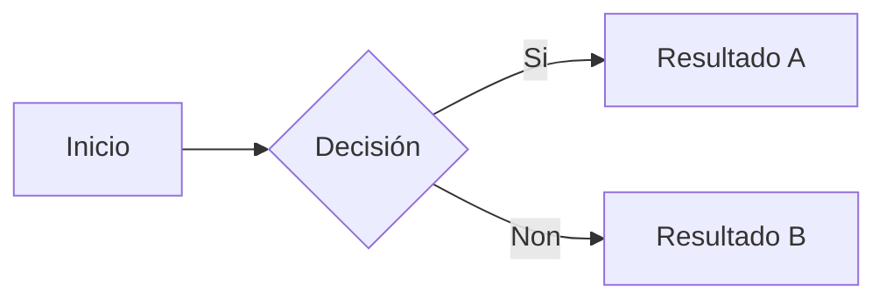
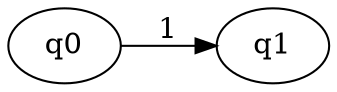

# md2pdf

Conversor de Markdown a PDF, DOCX e HTML5 multiplataforma (Linux e Windows) baseado en Pandoc. Dispón de tres motores de saída: **LuaLaTeX con template propio** (por defecto, calidade tipográfica máxima), **DOCX** (Word) e **HTML5 autocontido** (responsive, accesible e sen dependencias de execución no navegador).

Deseñado para producir documentación técnica de alta calidade a partir de ficheiros `.md`, con resaltado de sintaxe optimizado para linguaxes web (PHP, HTML, CSS, JavaScript, Bash, SQL, JSON), tipografía profesional e preprocesamento automático do Markdown.


## Características

### Conversión automática

Un só comando converte un ficheiro `.md`, varios ficheiros, ou un directorio completo a PDF, DOCX ou HTML5.

### Preprocesamento intelixente do Markdown

Antes de pasalo a Pandoc, o script preprocesa o Markdown:

- Eliminación automática de índices manuais (`## Índice` + listas de ligazóns) e marcadores `[TOC]` de Typora, xa que Pandoc xera o seu propio TOC.
- Eliminación de separadores horizontais (`---`) entre seccións.
- Eliminación de numeración manual nas cabeceiras (`## 1. Título` → `## Título`), xa que Pandoc numera automaticamente con `--number-sections`.
- Substitución de emojis por iconas vectoriais FontAwesome5 no texto (LuaLaTeX) e por texto plano dentro de bloques de código, onde os comandos LaTeX non son posibles.
- Conversión de callouts estilo GitHub/Obsidian (`> [!NOTE]`, `> [!WARNING]`, etc.) á sintaxe nativa de Pandoc (`::: note`).
- Admonitions automáticos en cabeceiras: as cabeceiras que conteñan "Tarefa", "Exercicio", "Reto" ou "Exemplo" reciben automaticamente un emoji identificativo.
- Corrección automática de bloques de código sen linguaxe: os bloques ` ``` ` sen especificar linguaxe (que desactivarían o resaltado de sintaxe) son detectados e rexistrados coma advertencias; co flag `--strict` considéranse erro.
- Enforce de liña en branco antes de callouts: garante a separación sintáctica que Pandoc require para interpretalos correctamente.
- Eliminación do YAML front matter antes do procesamento: o front matter extráese por separado para a xeración de metadatos e non se pasa como contido ao motor de renderizado.
- Protección do contido dentro de bloques de código: ningún dos preprocesamentos anteriores modifica o interior de bloques delimitados por ```.

### Callouts (bloques de aviso)

O filtro `callouts.lua` converte bloques de tipo callout en caixas visuais con cor e etiqueta, usando `tcolorbox`. Soporta a sintaxe de GitHub/Obsidian e a nativa de Pandoc:

Sintaxe GitHub/Obsidian (convertida automaticamente polo preprocesador):

```markdown
> [!NOTE]
> Lembra que `session_start()` debe ir antes de calquera saída HTML.

> [!WARNING]
> Nunca almacenes contrasinais en texto plano.
```

Sintaxe nativa Pandoc (tamén funciona):

```markdown
::: note
Lembra que `session_start()` debe ir antes de calquera saída HTML.
:::
```

Tipos dispoñibles (en inglés ou galego):

| Tipo | Aliases | Cor | Uso |
|---|---|---|---|
| `note` | `nota` | Azul | Información xeral |
| `tip` | `consello` | Verde | Boas prácticas |
| `warning` | `atención`, `atencion` | Laranxa | Precaución |
| `danger` | `perigo` | Vermello | Erros críticos |
| `info` | — | Cian | Datos técnicos |

### Admonitions automáticos en cabeceiras

O script detecta palabras clave nos títulos das cabeceiras e engade automaticamente un emoji identificativo. Configuración no dicionario `HEADING_ADMONITIONS` de `preprocess.py`:

| Patrón | Emoji | Icona LaTeX | Uso |
|---|---|---|---|
| Tarefa | 🎯 | `\faIcon[regular]{clipboard}` | Entregable obrigatorio |
| Exercicio | ✏️ | `\faPencilAlt` | Práctica guiada |
| Reto | 🏆 | `\faTrophy` | Desafío extra |
| Exemplo | ▶️ | `\faIcon[regular]{play-circle}` | Demostración |

Se a cabeceira xa ten un emoji, non se duplica. As iconas escálanse ao 90% (`\scalebox{0.9}`) para non dominar visualmente.

### Metadatos do documento

A saída incorpora metadatos estándar cando o formato os admite (título, idioma, autor, palabras clave) lexibles por lectores de PDF, buscadores e ferramentas de accesibilidade.

O **título** extráese automaticamente do primeiro `# Heading` do documento. O **idioma** tómase do argumento `--lang` (por defecto `gl`).

Os campos de metadatos extráense por orde de prioridade:

1. **Ficheiro `metadata.yaml`** no mesmo directorio do `.md`. O script busca primeiro `<prefixo-unidade>-metadata.yaml` (ex: `u3-metadata.yaml` para `U3A*.md`), despois `metadata.yaml` (tamén `.yml`).
2. **YAML front matter** no propio ficheiro `.md`, que **sobreescribe campo a campo** os valores do ficheiro externo.

#### Campos recoñecidos

| Campo | Onde aparece | Uso típico |
|---|---|---|
| `module` | Portada (`--titlepage`) | Módulo profesional (ex: "Desenvolvemento web en contorno servidor") |
| `subject` | Portada — título principal | Unidade didáctica (ex: "UD3: Introdución a PHP") |
| `activity` | Portada + primeira páxina de contido | Actividade concreta (ex: "A01: Estruturas de control") |
| `school` | Portada — bloque inferior | Nome do centro (ex: "CIFP Rodolfo Ucha Piñeiro") |
| `author` | Metadatos internos do PDF | Nome do docente; na portada úsase como alternativa a `school` se non hai centro definido |
| `course` | Portada — bloque inferior | Curso académico (ex: "Curso 2025-2026") |
| `keywords` | Metadatos internos do PDF | Palabras clave para buscadores |
| `decimal-align` | Táboas do PDF | `false` desactiva o aliñamento decimal das columnas numéricas (como `--no-decimal-align`) |
| `terminal-blocks` | Bloques de código (PDF/HTML) | `false` desactiva o fondo diferenciado de comandos de terminal (como `--no-terminal-blocks`) |

O campo `subtitle` acepta como alias de `activity` para compatibilidade con documentos anteriores.

Esta combinación permite compartir `author`, `school`, `keywords` e `course` nun `metadata.yaml` de directorio, e definir `module`, `subject` e `activity` en cada ficheiro `.md`:

```yaml
# metadata.yaml (compartido por todos os .md do curso)
author: "Miguel Morales"
school: "CIFP Rodolfo Ucha Piñeiro"
keywords: "PHP, DAW, Backend"
course: "Curso 2025-2026"
```

```markdown
---
module: "Desenvolvemento web en contorno servidor"
subject: "UD3: Introdución a PHP"
activity: "A01: Estruturas de control"
---

# A01: Estruturas de control
```

Se non hai ningunha das dúas fontes, o documento xérase igualmente sen eses campos. A opción `--no-metadata` desactiva completamente a extracción.

Para verificar os metadatos dun PDF:

```bash
pdfinfo documento.pdf | grep -E "Title|Author|Keywords|Creator"
```

### Modo impresión

A opción `--print` aplica unha paleta optimizada para impresión en branco e negro. En PDF afecta á composición LaTeX; en HTML aplica a mesma aparencia na pantalla e mantén ademais regras `@media print`:

- **Ligazóns en negro** — tanto URLs coma ligazóns internas (en pantalla son azuis).
- **Fondos de código eliminados** — bloques de código con fondo branco e borde gris; código en liña totalmente transparente (sen fondo de cor) con texto negro puro.
- **Táboas sen filas alternas** — elimina o sombreado gris das filas pares.
- **Callouts con fondo branco** — mantén o borde pero elimina o fondo de cor (LuaLaTeX).

```bash
md2pdf apuntes.md --print
md2pdf apuntes.md --print -o apuntes-imprimir.pdf
```

O ficheiro de pantalla e o de impresión pódense xerar en paralelo:

```bash
md2pdf apuntes.md && md2pdf apuntes.md --print -o apuntes-print.pdf
```

### Modo nocturno

A opción `--night` aplica ao PDF e ao HTML unha paleta de cores cálida, sen compoñente azul dominante, pensada para lectura con pouca luz:

- **Fondo xeral**: crema cálido `#F5F0E8`
- **Texto**: marrón escuro `#2C1A0E` (non negro puro, menos contraste extremo)
- **Bloques de código**: crema lixeiramente máis escuro `#EDE8DC`
- **Código en liña**: fondo crema cálido `#EDE8DC` (idéntico ao dos bloques de código) con texto marrón medio `#7A4F2E`
- **Ligazóns, callouts e título do TOC**: laranxa apagado `#8B6347`
- **Iconas** (tarefas, exercicios, avisos, etc.): redefinidas con catro tons marrón-laranxa segundo a súa función:

| Ton | Hex | Iconas |
|---|---|---|
| Laranxa apagado | `#8B6347` | consello, info, correcto, globo, reproducir, nota, foguete, obxectivo |
| Marrón medio | `#7A4F2E` | chave, cartafol, lapis, trofeo |
| Siena | `#A0522D` | aviso, erro, bug, parar, crítico |
| Beixe cálido | `#9E8872` | escritorio, bloqueo, configuración, portátil |

```bash
md2pdf apuntes.md --night
md2pdf apuntes.md --night -o apuntes-noite.pdf
```

A paleta aplícase a todos os elementos do documento: fondo, código, ligazóns, callouts, título do índice e todas as iconas. Ningún compoñente azul ou verde en toda a páxina.

### Motor DOCX (Word)

A opción `-e docx` xera un ficheiro `.docx` (Word/LibreOffice) directamente desde o mesmo Markdown, sen necesidade de ningún motor LaTeX — só Pandoc.

```bash
md2pdf apuntes.md -e docx
md2pdf apuntes.md -e docx -o apuntes.docx
md2pdf *.md -e docx
```

**Que funciona:**
- Cabeceiras, parágrafos, listas, táboas, notas ao pé → correctos
- Metadatos (título, autor) → propiedades do documento Word
- Callouts → convértense en texto con prefixo bold (`📝 Nota:`, `⚠️ Atención:`, etc.) mediante o filtro `callouts-docx.lua`
- TOC e numeración de seccións → xerados por Pandoc

**Limitacións:**
- Sen resaltado de sintaxe (DOCX non soporta o sistema de highlighting de Pandoc)
- As referencias propias `@fig:`/`@tbl:` de `figure-captions.lua` non se resolven en DOCX
- `--print`, `--titlepage` e `--listings` non aplican (ignóranse con aviso)

**Estilos personalizados (opcional):** se existe un ficheiro `reference.docx` no directorio de md2pdf, úsase como modelo de estilos (Heading 1, Normal, Source Code, etc.). Xerar un de base:

```bash
pandoc -o reference.docx --print-default-data-file reference.docx
# Editar en LibreOffice/Word os estilos desexados e gardar como reference.docx
```

### Motor HTML5

A opción `-e html` xera un único ficheiro `.html` autocontido mediante o writer HTML5 de Pandoc. O CSS, as imaxes locais e os diagramas SVG quedan embebidos co propio documento (`--embed-resources`), polo que o resultado pode abrirse ou distribuírse como un único ficheiro, igual que un PDF.

```bash
md2pdf apuntes.md -e html
md2pdf apuntes.md -e html -o apuntes.html
md2pdf *.md -e html
```

O motor reutiliza o mesmo preprocesamento e a mesma semántica do Markdown que LuaLaTeX:

- TOC compacto e centrado, sen puntos guía, con ligazóns internas.
- Numeración automática de seccións delegada en Pandoc (`--number-sections`), compartindo a mesma xerarquía co TOC.
- Callouts semánticos e responsive coas mesmas categorías (`note`, `tip`, `warning`, `danger`, `info`).
- Resaltado de sintaxe de Pandoc e soporte de `hl="..."` para destacar liñas concretas.
- Figuras e táboas numeradas con referencias `@fig:` e `@tbl:`/`@tab:` navegables; tamén se normalizan os pés de figura herdados do formato `*Figura N. ...*` para evitar duplicar a numeración.
- Mermaid, D2, Graphviz e Vega-Lite en **SVG vectorial** cando o renderizador correspondente está dispoñible.
- Ecuacións en MathML, sen depender de MathJax nin doutro JavaScript externo.
- `--night`, `--print`, `--plain`, `--no-toc`, `--no-number`, `--watch` e `--strict`.
- Deseño responsive para móbil/escritorio e regras específicas de impresión con CSS Paged Media básico.

O HTML usa `md2pdf.html`, `md2pdf.css` e `html.lua`. As decisións de paxinación exclusivas de LaTeX (`needspace`, `longtable`, táboas pequenas, etc.) non se trasladan ao HTML de pantalla; para impresión úsanse propiedades CSS como `break-after: avoid-page` e `break-inside: avoid-page`.

`--titlepage` non aplica a HTML: o título intégrase na propia páxina. `--listings` segue sendo exclusivo de LuaLaTeX.

### Paquetes IMS para Moodle

`md2pdf` pode empaquetar varios Markdown como **IMS Content Package** para Moodle, reutilizando o motor HTML5 autocontido:

```bash
md2pdf U1/ --ims U1-moodle.zip
md2pdf U1/*.md --ims U1-moodle.zip --ims-title "UD1. Introdución á programación"
```

O ZIP contén `imsmanifest.xml` na raíz e un HTML autocontido por documento. A orde do menú IMS respecta a orde dos ficheiros; os títulos toman `activity`, `title`, o primeiro H1 ou, como fallback, o nome do ficheiro. As ligazóns entre `.md` incluídos no mesmo paquete convértense automaticamente a ligazóns entre os HTML. Con `--strict`, unha ligazón local a un Markdown non incluído impide publicar o paquete.

IMS é unha capa de empaquetado, non un motor adicional: PDF, DOCX e HTML continúan sendo os tres motores de renderizado. Máis detalles en [IMS.md](IMS.md).

### Resaltado de liñas en bloques de código

O atributo `hl="..."` permite destacar liñas específicas dentro dun bloque de código. En LuaLaTeX aplícao `hl-lines.lua`; en HTML Pandoc conserva o atributo como `data-hl` e o template marca as liñas correspondentes no navegador. DOCX non implementa esta característica.

Sintaxe:

```markdown
```php {hl="1,3,5-7"}
<?php
$usuario = $_POST['usuario'];   // ← liña 1 destacada
$hash = password_hash($pass, PASSWORD_DEFAULT);
echo $usuario;                  // ← liña 3 destacada
$stmt = $pdo->prepare($sql);
$stmt->execute([$hash]);        // ← liñas 5-7 destacadas
$result = $stmt->fetch();
```
```

A cor de fondo das liñas destacadas é un amarelo suave por defecto. Para personalizala, engadir en `md2pdf-preamble.tex`:

```latex
\colorlet{hl-line-bg}{yellow!18!white}
\fvset{highlightcolor=hl-line-bg}
```

Nota: a implementación usa `highlightlines` nativo de `fvextra`, polo que é compatible co resaltado de sintaxe de Pandoc.

### Diagramas: Mermaid, D2 e Graphviz

Tamén se admiten gráficos de datos con [Vega-Lite](VEGA-LITE.md):
histogramas, liñas, puntos, regresións e sectores. Exemplos en
[exemplos-vega-lite.md](exemplos-vega-lite.md).

Consulta [Diagramas configurables](DIAGRAMAS.md) para seleccionar layout,
engadir pés e referencias e establecer valores predeterminados por documento.

Os bloques de código con linguaxe `mermaid` renderízanse automaticamente como diagramas vectoriais incrustados no PDF:

````markdown

````

A renderización faina o paquete `md2pdf/diagrams/` (coa API de compatibilidade `md2pdf/mermaid.py`) chamando a `mmdc` (Mermaid CLI) e substituíndo cada bloque pola imaxe xerada antes de pasar o documento a Pandoc. O formato escóllese segundo o motor:

- **LuaLaTeX** → PDF vectorial axustado ao diagrama (con `--pdfFit` en versións clásicas de `mmdc` ou con autodetección de recorte nativo en `mmdc 12.0.0+`, onde a opción foi retirada)
- **DOCX** → PNG
- **HTML5** → SVG vectorial embebido no ficheiro final

Soporta todos os tipos de diagrama de Mermaid: `flowchart`, `sequenceDiagram`, `classDiagram`, `stateDiagram`, `erDiagram`, `gantt`, `pie`, `mindmap`, etc.

#### Caché por hash

Cada diagrama almacénase con nome `<hash-SHA1>.<formato>` en `/tmp/md2pdf-mermaid/` (Linux/macOS) ou `%TEMP%\md2pdf-mermaid\` (Windows). Os diagramas idénticos non se re-renderizan entre execucións sucesivas, polo que `--watch` con documentos con moitos diagramas é case instantáneo a partir da segunda compilación.

A invocación de `mmdc` usa `subprocess.run()` con `stdin=DEVNULL`, env controlado, timeout de 60s e un ficheiro de configuración de Puppeteer con `--no-sandbox` (necesario en moitos entornos onde Chromium non pode usar o sandbox).

A imaxe inserida leva un ancho explícito calculado a partir das dimensións (sobrescribible con `width=...`) para evitar un problema coñecido de LuaLaTeX onde imaxes vectoriais sen tamaño definido fan que o motor se colgue indefinidamente.

#### Requisitos

- **Arch Linux**: `sudo pacman -S mermaid-cli`
- **Windows**: ver `INSTALL_WINDOWS.md`, sección 4
- **Outros**: `npm install -g @mermaid-js/mermaid-cli`

Se `mmdc` non está instalado, os bloques mantéñense como código fonte no documento e emítese un aviso en stderr (sen fallo de compilación; con `--strict` aborta).

O mesmo motor acepta bloques `d2`, `dot` e `graphviz`. Cada ferramenta é
opcional e independente: só se comproba o executable cando o documento contén
un bloque desa linguaxe. D2 emprégase para diagramas conceptuais e de
arquitectura; DOT/Graphviz resulta especialmente útil para grafos, árbores e
autómatas.

````markdown
```d2
cliente -> servidor: HTTP
servidor -> base_de_datos: SQL
```


````

En Arch Linux pódense instalar con `sudo pacman -S d2 graphviz`. Os resultados
usan o mesmo esquema de caché e os mesmos formatos por motor que Mermaid.

### Ecuacións matemáticas

Pandoc converte a sintaxe LaTeX estándar (`$...$` e `$$...$$`). A fonte matemática está configurada para emparellar coa tipografía do documento.

**Fonte:** STIX Two Math. Encaixa con Source Serif 4 porque ambas son serifs transicionais modernizadas para medios dixitais, con proporcións e contraste de trazo similares.

Require instalar a fonte:
```bash
sudo pacman -S otf-stix
```

Sintaxe:

```markdown
Ecuación en liña: $E = mc^2$

Ecuación en bloque:

$$\int_a^b f(x)\,dx = F(b) - F(a)$$

```

As ecuacións en bloque represéntanse coa numeración e o comportamento propios de LaTeX/Pandoc, pero md2pdf non resolve actualmente referencias `@eq:`.

### Referencias cruzadas

md2pdf resolve referencias de **figuras e táboas** sen depender de `pandoc-crossref`: `figure-captions.lua` faino en LuaLaTeX e `html.lua` en HTML5.

Sintaxe no Markdown:

```markdown
{#fig:diagrama}

Como se mostra na @fig:diagrama, o proceso consta de tres fases.

| Motor    | Velocidade | Calidade |
|----------|------------|----------|
| LuaLaTeX | lenta      | máxima   |
| DOCX     | rápida     | media    |

: Comparativa de motores {#tbl:motores}

Como mostra a @tbl:motores...
```

Admítense `@fig:...` para figuras e `@tbl:...`/`@tab:...` para táboas. A forma coa inicial maiúscula (`@Fig:...`, `@Tbl:...`) produce «Figura»/«Táboa» en vez de «figura»/«táboa». En HTML as referencias son ligazóns internas clicables. As referencias `@sec:`, `@eq:` e `@lst:` non se resolven automaticamente polo pipeline actual. En DOCX tampouco se aplica este sistema propio de referencias.

### Validación do Markdown

A validación execútase automaticamente antes de cada conversión. Informa de problemas estruturais como:

- marca BOM ao inicio do ficheiro;
- front matter YAML sen pechar ou que abrangue accidentalmente parte do corpo;
- bloques de código sen linguaxe ou sen pechar;
- callouts `:::tipo` sen a liña baleira requirida, sen pechar ou con peches soltos;
- múltiples cabeceiras de nivel 1 (`#`).

Por defecto estes problemas móstranse como avisos e a conversión continúa. Con `--strict`, calquera deles fai abortar antes de executar Pandoc e devolve código de saída distinto de cero:

```bash
md2pdf apuntes.md --strict
md2pdf *.md --strict
```

### Tipografía profesional

Familia tipográfica baseada na familia Source de Adobe, configurada vía variables de Pandoc:

- **Source Sans 3** ou **Source Sans Pro** — corpo do texto e títulos por defecto (sans-serif); optimizada para lectura en pantalla, coherencia con código técnico e accesibilidade educativa
- **Source Serif 4** — modo serif para o corpo do texto mediante a opción `--serif` (ou metadatos `body-font: serif`), recomendado para documentos pensados para impresión en papel
- **Source Code Pro** / **JetBrains Mono** — código fonte (monoespaciada, Scale=0.85, sen ligaduras)

Cifras Lining aplícanse automaticamente dentro de táboas mediante `\AtBeginEnvironment`.

### Cabeceiras con cor

As cabeceiras de sección reciben cor para reforzar a xerarquía visual. En modo día úsase unha paleta de **azul pizarra** de tres tons; en modo nocturno (`--night`) substitúese por **tostado ámbar** coherente coa paleta cálida:

| Nivel | Modo día | Modo nocturno |
|---|---|---|
| `##` (section) | `#1C2F4A` (pizarra escuro) | `#6B3A1F` (tostado escuro) |
| `###` (subsection) | `#2E4B72` (pizarra medio) | `#8B5230` (tostado medio) |
| `####` (subsubsection) | `#4A6A96` (pizarra claro) | `#A86A42` (tostado claro) |

En modo impresión (`--print`) todas as cabeceiras van en negro.

### Microtipografía

O paquete `microtype` configúrase con:

- **Character protrusion**: puntuación e guións sobresaen lixeiramente das marxes, creando unha marxe óptica máis uniforme.
- **Font expansion**: axuste microscópico do ancho dos glifos (±1%) para mellor xustificación.
- Resultado: menos "ríos brancos" no texto xustificado e menos hifenacións innecesarias.

### Espazado vertical tipográfico

Baseado nos principios de Bringhurst (*The Elements of Typographic Style*) e Müller-Brockmann:

- **Parskip** (0.45em): ~50% do interliñado, para separar parágrafos sen indentación.
- **Cabeceiras**: espazo antes ≥ 2× espazo despois (principio de proximidade de Gestalt — a cabeceira está máis preto do contido que introduce que do anterior).
- **Listas**: `topsep` 0.1em (espazo antes/despois da lista ≈ parskip), `itemsep` 0.25em entre ítems.
- **Bloques de código**: `after skip` (0.7em) > `before skip` (0.45em) porque o borde inferior crea unha fronteira visual ríxida.
- **Blockquotes**: `after skip` (0.6em) > `before skip` (0.45em) polo mesmo motivo.

Xerarquía de espazado en LuaLaTeX (con `\parskip` 0.45em engadido):

| Elemento | beforeskip | afterskip | Espazo real antes | Espazo real despois | Ratio |
|---|---|---|---|---|---|
| Section | 1.2em | 0.4em | ~1.65em | ~0.85em | ~1.9× |
| Subsection | 1.0em | 0.3em | ~1.45em | ~0.75em | ~1.9× |
| Subsubsection | 0.8em | 0.3em | ~1.25em | ~0.75em | ~1.7× |

### Protección de orfas, viúvas e cabeceiras

- **Orfas e viúvas**: `\widowpenalty=3000`, `\clubpenalty=3000` e `\displaywidowpenalty=2000` desaconsellan liñas solitarias ao inicio/final de páxinas sen bloquear de maneira absoluta a composición.
- **Cabeceiras**: `\Needspace` vía `\pretocmd` reserva 8, 7 e 6 liñas base antes de `section`, `subsection` e `subsubsection`, respectivamente. Se a cabeceira vai xusto despois doutra (sección + subsección), non se reserva nada: `\Needspace` forzaría o salto entre as dúas e deixaría a primeira soa ao final da páxina. Detéctase con `\if@nobreak`, que LaTeX mantén activo desde unha cabeceira ata o primeiro parágrafo; a reserva da primeira cabeceira xa protexe o conxunto.
- **Cabeceira + táboa pequena**: cando unha táboa de ata 6 filas aparece inmediatamente despois dunha cabeceira, `small-table.lua` fai unha única reserva conxunta antes da cabeceira. Así evita que a cabeceira quede soa ao final da páxina sen aumentar globalmente as reservas 8/7/6. Se hai varias cabeceiras seguidas (sección + subsección + táboa), a reserva vai antes da primeira e suma tres liñas por cada cabeceira anterior; se fose só antes da última, o salto quedaría entre elas.
- **Táboas pequenas independentes**: manteñen a súa propia reserva `número de filas + 5` antes do `tabular`; as táboas de 7 ou máis filas seguen como `longtable` e poden partir entre páxinas.

### Hifenación multilingüe

- **Lingua principal**: galego (vía `-V lang=gl`)
- **Linguas secundarias**: inglés e castelán (vía `-V babel-otherlangs=english,spanish`)
- **Tolerancia**: `\tolerance=1500` permite espazos lixeiramente máis amplos para reducir hifenacións innecesarias.
- **Excepcións manuais**: ~40 termos técnicos frecuentes en desenvolvemento web con hifenación correcta (func-tion, con-trol-ler, mid-dle-ware, frame-work, java-script, tem-plate, etc.)

### Resaltado de sintaxe

Tema personalizado `drake-jb.theme` baseado na paleta GitHub Light con 13 cores diferenciables optimizadas para linguaxes web. Todas as cores cumpren **WCAG AA** (ratio de contraste ≥ 4.5:1) sobre o fondo de código `#f6f8fa`. O script detecta automaticamente o ficheiro `.theme` no directorio do script ou de traballo.

### Anchos de táboas proporcionais ao contido

Filtro Lua (`auto-table-widths.lua`) que substitúe os anchos arbitrarios que Pandoc calcula a partir dos guións do Markdown. O filtro:

- Analiza o contido real de cada cela.
- Se todo o contido cabe sen partir liñas en como moito o 85 % da liña, a táboa queda co seu ancho natural e centrada, en vez de estirarse deixando ocos entre columnas. As táboas con algunha columna baleira no corpo (para que o alumnado a encha) ocupan sempre toda a liña.
- Limita a lonxitude efectiva por cela a 60 caracteres (evita que código moi longo nunha columna espreme as demais).
- Garante un ancho mínimo baseado no texto da cabeceira (as cabeceiras non deben romper liñas).
- Garante un ancho mínimo para código monoespaciado curto (como `@deprecated`) para evitar hifenacións forzadas.
- Garante que cada columna colle a palabra máis longa sen espazos de calquera das súas celas (por exemplo «Enteiro» ou «Decimal»), para que LaTeX non a divida con guión. Os anchos estímanse con táboas de ancho por glifo medidas en `\small` (`Source Sans 3` regular no corpo por defecto, ou `Source Serif 4` en modo `--serif`, `Source Sans 3` negra na cabeceira, `Source Code Pro` no código). As palabras que TeX non pode dividir (menos de catro letras seguidas, como `CA1.8` ou unha ruta `/etc/php/8.5/cli/php.ini` escrita como texto) non se parten: só invaden o espazo entre columnas, así que só obrigan a axustar se invadirían máis de 8 pt. O código conta ata o seu primeiro punto de corte.
- O espazo que falte sae das outras columnas punto a punto: cada vez da que menos altura engade á táboa, simulando o reparto das palabras en liñas de cada cela, e en empate da que máis lle sobra sobre o seu propio mínimo, que adoita ser a de máis texto. Como a estimación pode errar un par de puntos, cada columna valórase 2 pt máis estreita do que quedaría, para non recortar as que teñen algunha liña xusto no límite.
- Como o mínimo pola cabeceira, o mínimo por palabras non se aplica se pasaría do 60 % da liña. Se os mínimos non caben todos, cúmprense os máis pequenos e as columnas de palabras máis longas repártense o resto: esas partirán a palabra, pero as outras non.

#### Anchos manuais

Se a liña separadora ten guións de lonxitude distinta, Pandoc calcula anchos relativos a partir deles e o filtro respéctaos: só aplica o estilo da cabeceira.

```markdown
| Tipo | Descrición | Exemplo |
|------|--------------------------|------------|
```

Pandoc só calcula estes anchos cando algunha liña da táboa pasa de 72 caracteres; nas táboas estreitas non hai anchos que respectar. Ademais conta tamén os dous puntos de aliñamento como parte da columna, así que `|:---:|---|---:|` dá anchos 5:3:4 aínda que os guións sexan iguais. Para distinguir ese caso dun ancho manual, o filtro busca un número de guións *d* común a todas as columnas que explique os anchos (ancho proporcional a *d* + dous puntos, con 2 para centrado, 1 para esquerda ou dereita e 0 sen aliñamento). Se o atopa, os guións son iguais e segue o cálculo automático.

### Táboas longas

As táboas que non caben nunha soa páxina continúan automaticamente na seguinte con a cabeceira repetida. Pandoc xera `longtable` con `\endhead`, polo que a repetición de cabeceira é nativa.

O preámbulo corrixe un problema de `\rowcolors`: usa un contador de estado global que non se resetea entre táboas. Sen a corrección, as cores de filas alternas desincronízanse entre táboas consecutivas. O reset en `\AtBeginEnvironment{longtable}` garante que cada táboa comeza co patrón correcto (fila 1 = cabeceira sen cor, fila 2 = gris, fila 3 = branco...).

Nota: nunha táboa moi longa que salte varias páxinas, as cores poden lixeiramente desfasarse na páxina de continuación. É un efecto cosmético menor sen solución sinxela en LuaLaTeX.

### Saltos de liña en celas de táboa

O filtro `br.lua` converte as etiquetas HTML `<br>` dentro de celas de táboa en `\newline{}` de LaTeX, permitindo forzar saltos de liña dentro dunha mesma cela. Esta conversión só afecta ao interior de táboas; no resto do documento `<br>` trátase normalmente por Pandoc.

### Aliñamento vertical de táboas

Pandoc xera columnas de tipo `p{}` para todas as columnas con ancho calculado. `p{}` aliña o contido cara arriba por defecto, que é o comportamento correcto para documentación técnica.

O único problema era que o **código en liña** (`\mbox{\texttt{...}}`) dentro de celas altas aliñaba pola liña base en vez de pola parte superior. O filtro `auto-table-widths.lua` corrixe isto engadindo `\leavevmode` antes de cada `\mbox`, que ancora o contido á parte superior do `\parbox` de forma consistente co texto normal.

> **Nota técnica:** `\newcolumntype{p}[1]{...p{#1}}` causa recursión infinita en LuaLaTeX con `polyglossia` e `fontspec`. Non se usa esta redefinición.

### Estilo de táboas técnicas

O preámbulo e o filtro `auto-table-widths.lua` aplican automaticamente un conxunto de melloras tipográficas en todas as táboas:

- **Fonte reducida**: `\small` (11,86 pt con 13 pt de base, medido); entreliña de 17,14 pt, 1,45 veces o tamaño, a mesma proporción ca o corpo (`\setstretch{1.2083}`)
- **Separación entre filas**: `\arraystretch{1.5}` — entre filas queda media liña máis ca entre as liñas dunha cela (8,57 pt), a mesma proporción ca `\parskip` entre parágrafos. No HTML, a táboa herda o `line-height` do corpo (1,56; 1,52 en pantallas estreitas) e o `padding` vertical, `.37rem` (`.36rem` en pantallas estreitas), tamén é media liña
- **Padding horizontal**: `\tabcolsep{6pt}` — espazo a cada lado das celas
- **Cabeceiras en sans-serif bold con cor**: o filtro `auto-table-widths.lua` envolve cada cela de cabeceira en `\textsf{\bfseries\color{heading-section}{...}}`, usando o mesmo ton que as cabeceiras de sección (azul pizarra en día, tostado ámbar en noite, negro en impresión) e eliminando o `\textbf` que Pandoc xa inxecta para evitar dobre bold
- **Sen liñas horizontais**: `\toprule`, `\midrule` e `\bottomrule` están suprimidos; coas cabeceiras en cor e o zebra striping as liñas son redundantes e ademais `\toprule` repetiríase incorrectamente en cada páxina de continuación de táboas longas
- **Zebra striping**: filas alternas en `gray!6!white` para facilitar a lectura horizontal
- **Aliñamento decimal**: nunha columna na que todas as celas son números (`9`, `-2`, `3.5`, `0,75`; as baleiras permítense) e polo menos un ten parte decimal, as unidades e o separador decimal quedan na mesma vertical. Cada cela ocupa o mesmo ancho, así que o aliñamento que marque o Markdown move o bloque enteiro: con `|:-:|` a columna queda centrada pero aliñada polo decimal. Só no PDF. Desactívase con `--no-decimal-align` ou con `decimal-align: false` no front matter ou no `metadata.yaml`

```markdown
| Operador | Operación | Exemplo | Resultado |
|:-:|---|:-:|:-:|
| `*` | Multiplicación | `7 * 2` | 14 |
| `/` | División | `7 / 2` | 3.5 |
```

### Código en liña intelixente

O filtro Lua e o preámbulo xestionan conxuntamente o código en liña en LaTeX para garantir unha renderización limpa e uniforme:

- **Comportamento por defecto (sen fondo):**
  - Todo o código en liña amósase con tipografía monoespazada na cor temática axeitada (azul `#0550ae` en día, marrón `#7A4F2E` en noite, negro puro en impresión) sen caixas nin fondos de cor, asegurando total coherencia visual en calquera documento.
- **Modo opcional tipo «píldora» (`--inline-pill`):**
  - O fondo tipo «píldora» pódese activar coa opción de comando `--inline-pill`, engadindo `inline-pill: true` nos metadatos YAML/front matter, ou con `\mdpdfinlinepilltrue` no preámbulo LaTeX.
  - **Cantos lixeiramente redondeados** (`1.5 pt`) e recheo lateral microscópico (`1.5 pt`).
  - **Recheo vertical nulo** (`0 pt`, con `tcbox raise base`): non altera a entreliña dos parágrafos nin deforma o ritmo vertical.
  - **Cores adaptadas a cada modo:** fondo gris neutro tenue `#F0F2F5` en modo día, crema cálido `#EDE8DC` en noite e transparente (`blankest`) en impresión.
- **División e rotura de liñas intelixente:**
  - Código curto (≤ 8 caracteres ou ≤ 15 sen separadores) como `$price`, `int`, `@deprecated`, `true` → envólvese en `\leavevmode\mbox{}` para mantelo indivisible e ancoralo á parte superior en celas de táboa.
  - Rutas longas e comandos (`/etc/php/8.3/...`, `$a && $b`) → o filtro `auto-table-widths.lua` engade puntos de corte automáticos (`\discretionary`, `\allowbreak`). O estilo LaTeX detecta estes puntos e evita encapsular a ruta nunha caixa ríxida indivisible, garantindo que as rutas rompan con naturalidade sen desbordar a marxe dereita nin en prosa nin en táboas.

**Limitación coñecida (LuaLaTeX):** as secuencias con barra invertida (`\n`, `\t`, `\\`) dentro de código en liña (acentos graves) na prosa renderízanse incorrectamente porque `\texttt{}` interpreta a barra como inicio de comando LaTeX (por exemplo, `\n` aparece como `\{}n`). Dentro de bloques de código fenced non hai problema. A solución é describir o carácter con palabras na prosa ou usar un bloque de código.

### Rotura de liñas e páxinas en bloques de código

O paquete `fvextra` redefine `verbatim` para que liñas longas rompan automaticamente con un indicador visual `↪` (gris discreto), evitando que o texto se saia da páxina en bloques de código sen linguaxe especificada.

Os bloques de código que non caben nunha soa páxina **córtanse na marxe inferior e continúan na páxina seguinte**, en LuaLaTeX mediante `tcolorbox[breakable]`. O borde do bloque trunca visualmente na páxina 1 e reabre na páxina 2.

### Diferenciación de bloques de código e terminal

Para evitar que o alumnado confunda ordes de consola co código fonte dun programa ou aplicación web (un erro pedagóxico e técnico habitual en informática), os bloques de código que conteñen comandos de terminal (`bash`, `sh`, `shell`, `zsh`, `console`, `terminal`, `powershell`, `pwsh`, `cmd`, `bat`, `fish`) preséntanse automaticamente cun fondo e bordo sutilmente diferenciados:

- **Modo día:** fondo gris/ardósia fresco `#EEF1F5` con bordo `#D0D7DE` (fronte ao `#F6F8FA` e `#E1E4E8` do código estándar).
- **Modo nocturno (`--night`):** fondo area/tostado cálido `#E2DDD0` con bordo `#C5B99E` (fronte a `#EDE8DC` e `#D4C8B0`).
- **Modo impresión (`--print`):** fondo gris moi sutil `#F2F2F2` cun bordo definido `#8C8C8C` (fronte ao fondo branco do código normal), garantindo a diferenza sobre papel sen gastar tóner innecesario.

**Criterio de deseño limpo e prevención de erros:**
Non se inxectan símbolos de *prompt* (`$`, `>`, `#`, `>_`) nin cabeceiras adicionais no bloque. Deste xeito asegúrase que, ao seleccionar e copiar comandos desde o PDF ou HTML para pegalos no terminal, non se copien caracteres estraños que poidan causar fallos de execución (`command not found`).

Pódese desactivar coa opción `--no-terminal-blocks` na CLI ou engadindo `terminal-blocks: false` nos metadatos YAML.

### Portada e etiqueta de actividade

O script xera dous modos de presentación do título, ambos construídos en LaTeX puro:

**Modo por defecto (sen `--titlepage`):**
- A etiqueta `activity` aparece en `\LARGE\bfseries` centrada, con **liñas decorativas** arriba e abaixo axustadas exactamente ao ancho do texto (`\sbox`/`\wd`), antes do TOC.
- A mesma etiqueta repítese ao inicio da primeira páxina de contido, separando visualmente o TOC do corpo.
- A cor da etiqueta e das liñas decorativas usa o ton `heading-section` (`#1C2F4A` en día, tostado en noite, negro en impresión).
- Sen `activity`, non se xera ningunha etiqueta.

**Modo con `--titlepage`:**
- Portada completa con xerarquía tipográfica pura (sen liñas nin caixas decorativas):
  - `module` en versaletas con tracking amplo, muted — identificador de contexto
  - `subject` en `\Huge\bfseries` — título principal
  - `activity` en `\Large` — subtítulo inmediato
  - `school` e `course` no bloque inferior á dereita
  - `author` úsase como alternativa a `school` na portada se non hai centro definido
- A etiqueta `activity` aparece tamén ao inicio da primeira páxina de contido.

O espazo en branco superior (~28% da altura da páxina) é o elemento de deseño principal da portada. En modo `--night`, todos os elementos adaptan a paleta cálida mantendo a coherencia co resto do documento.

### Cabeceiras limpas

Sen texto nin liñas separadoras nas cabeceiras de páxina, só número de páxina centrado no pé. Configurado vía `\AfterEndPreamble` con KOMA-Script (`\clearpairofpagestyles`).

### Imaxes e figuras

As imaxes limítanse automaticamente ao ancho da liña de texto (`max width=\linewidth`), evitando que imaxes grandes sobresaian das marxes.

> **Imaxes moi grandes (>800 px de ancho) ou PDF vectoriais sen tamaño intrínseco** poden colgar LuaLaTeX indefinidamente. Isto ocorre porque a combinación de `\pandocbounded{}` (Pandoc 3.x), `adjustbox` con `max width=\linewidth` e `float{H}` entra nun bucle calculando o tamaño. **Solución**: redimensionar a imaxe a ≤800 px (`magick img.png -resize 800x img.png`) ou forzar o ancho no Markdown con `{width=100%}`:
>
> ```markdown
> {width=100%}
> ```

Os pés de figura (``) amósanse centrados, en fonte pequena, con a etiqueta "Figura N." en negra e punto separador. O estilo aplícase mediante o paquete `caption` en `\AtBeginDocument`.

> **Pendente:** Bordes para capturas de pantalla. A aproximación con `cfbox` vía `adjustbox` compila correctamente pero o borde non é visible no PDF. Require investigación con un enfoque diferente (posiblemente un entorno `figure` personalizado con `tcolorbox`).

### Tres motores de saída

- **LuaLaTeX con template propio** (por defecto): calidade tipográfica máxima, fonte a 13pt (~80-86 chars/liña), microtipografía, táboas con cabeceiras sans-serif bold e aliñamento superior, filas alternas de cor, iconas FontAwesome5 vectoriais, notas ao pé elegantes, ecuacións con STIX Two Math. Tempo de compilación ~3-5s.
- **DOCX**: xera `.docx` (Word/LibreOffice) directamente. Non require LaTeX. Útil para entregar materiais en formato editable ou para Xefatura de Estudos. Callouts convertidos a texto con prefixo bold.
- **HTML5**: xera un único `.html` responsive e autocontido. Mantén TOC, callouts, resaltado, `hl=`, referencias de figuras/táboas, SVG vectorial e modos nocturno/impresión mediante tecnoloxías web nativas.

### Melloras pendentes (TODOs)

Quedan rexistradas as seguintes melloras técnicas e pedagóxicas identificadas para futuras iteracións de `md2pdf`:

#### Melloras pedagóxicas e de interacción

1. **Callouts interactivos con formularios PDF (*AcroForms*) e áreas de notas/tarefas:**
   - Incorporar soporte para caixas de resposta e cadros de notas editables dentro dos callouts (por exemplo, `> [!TAREFA]` ou bloques `:::task-box{id="t1" height="3.5cm"}`) utilizando a contorna `Form` e `\TextField[multiline=true]` de `hyperref` en LuaLaTeX.
   - Permite que o alumnado escriba directamente no PDF as respostas a exercicios de autoavaliación, trazas de código ou notas de clase, podendo gardar o ficheiro (`Ctrl+S`) cos seus textos persistidos no documento en calquera visor PDF estándar ou navegador web.
   - Paridade en saída HTML5 (`-e html`) mediante elementos `<textarea>` con persistencia automática en `localStorage` do navegador.
   - Idóneo para a recollida e entrega directa de actividades en Moodle sen requirir formatos externos, mantendo compatibilidade con impresión en papel (onde se imprime como cadro baleiro delimitado para escritura manual).
2. **Opción de maquetación asimétrica para guías de estudo / Método Cornell (`--notes`):**
   - Ofrecer como opción de liña de comandos (`--notes` ou `--cornell`) unha marxe exterior ampliada (40–45 mm) e liña de texto reducida a ~65 CPL para materiais pensados especificamente para a toma de notas manuscritas intensivas en papel ou tabletas con estilete dixital, preservando a simetría estándar de 22 mm para documentos técnicos xerais con código fonte.

#### Melloras tipográficas e técnicas

1. **Mellora de listas procedementais («Paso a paso»):**
   - Nas guías prácticas con pasos numerados (`1.`, `2.`, `3.`), engadir máis separación vertical (`itemsep=0.5em` vía `enumitem`) e resaltar os números en semibold/negra coa cor corporativa (`heading-section`).
   - Evita que pasos con varias liñas se confundan visualmente cos pasos contiguos.
2. **Reforzo semántico en caixas de aviso (*Callouts*):**
   - En `callouts.lua`, xerar títulos formais en negra por defecto cando o autor non especifique un explícito (por exemplo, `⚠️ ATENCIÓN: ERRO HABITUAL`, `💡 CONSELLO PRÁCTICO`, `🎯 OBXECTIVO DA TAREFA`).
   - Facilita a lectura rápida en diagonal antes de iniciar tarefas prácticas.
3. **Soporte tipográfico para teclas e atallos (`<kbd>`):**
   - Filtro Lua para procesar etiquetas `<kbd>` e renderizalas coma teclas físicas tridimensionais con cantos redondeados e bordo sutil (estilo GitHub / MDN).
   - Diferencia claramente as accións físicas de teclado (`Ctrl + C`, `Alt + Shift + F`) do código en liña común.
4. **Estabilización de código en liña con fondo («píldora»):**
   - Resolver a interacción entre `\newtcbox` e os puntos de quebra intelixentes (`\discretionary`, `\allowbreak`) xerados por `auto-table-widths.lua` en rutas longas, de xeito que `--inline-pill` poida activarse por defecto con estabilidade total.
5. **Bordes para capturas de pantalla e imaxes con fondo claro:**
   - Crear unha contorna de figura con marco sutil mediante `tcolorbox` para evitar que imaxes con fondo branco se fundan coa páxina (a alternativa con `cfbox` vía `adjustbox` non resultaba visible no PDF).
6. **Tratamento de barras invertidas en código en liña (`\n`, `\t`, `\\`):**
   - Resolver o conflito polo cal `\texttt{}` interpreta as barras invertidas no texto corrido como macros LaTeX en vez de caracteres literais.


## Uso con asistentes de IA

O ficheiro `docs/md2pdf-ai-reference.md` é a referencia única para pasarlle a unha IA (Claude, ChatGPT, etc.) no prompt do sistema ou ao inicio dunha conversa, de xeito que xere materiais docentes en Markdown directamente compatibles con md2pdf. Reúne nun só documento:

- **Parte I. Criterios pedagóxicos e editoriais:** secuencia de aprendizaxe, estrutura das actividades, terminoloxía, elección entre táboa, diagrama e gráfico, uso semántico dos callouts, tarefas e solucionarios, accesibilidade.
- **Parte II. Sintaxe e convencións de md2pdf:** front matter, cabeceiras, callouts, código, diagramas (Mermaid, D2, Graphviz, Vega-Lite), táboas, figuras, referencias, ligazóns e IMS, coas diferenzas entre PDF, HTML e DOCX.
- **Parte III. Validación e entrega:** avisos, `--strict`, erros de LaTeX e lista de comprobación final.

### Por que é necesario

Os modelos de linguaxe xeran Markdown de estilo GitHub que, sen contexto adicional, choca co pipeline:

- Escriben listas e táboas sen liña baleira antes, que Pandoc converte en texto plano.
- Escriben `## 1. Sección` cando md2pdf numera automaticamente, e `## Índice` ou `---` que md2pdf elimina.
- Usan bloques de código sen linguaxe, diagramas sen pé (aviso de accesibilidade en HTML) ou referencias `@sec:`/`@eq:` que non se resolven.
- Descoñecen os callouts (`::: note`, `::: warning`…) e o campo `activity` do front matter.

### Como usalo

Inclúe o contido de `docs/md2pdf-ai-reference.md` no prompt do sistema ou como primeira mensaxe da conversa, xunto coa guía da unidade ou os materiais existentes se os hai:

```
[Contido de md2pdf-ai-reference.md]

Xera a actividade [tema] seguindo estritamente a referencia anterior.
```

### Limitacións que a IA non pode resolver por ti

Aínda coa referencia, hai decisións que requiren criterio docente:

- **Que liñas resaltar con `hl=`** — depende de cal é o punto pedagóxico de cada bloque.
- **Que información merece un callout e de que tipo** — `warning` vs `danger` require xuízo sobre a gravidade.
- **Estrutura das seccións** — a xerarquía de `##`/`###` debe reflectir a lóxica do contido.
- **Lexibilidade das figuras** — md2pdf avisa de texto pequeno nos diagramas, pero hai que revisar visualmente o resultado.


## Ficheiros do proxecto

```
md2pdf/
├── md2pdf/                    Paquete Python (módulo principal)
│   ├── __init__.py            Inicialización do paquete
│   ├── __main__.py            Punto de entrada CLI (inclúe --watch)
│   ├── config.py              Constantes e rutas base
│   ├── assets.py              Busca de ficheiros de recursos
│   ├── metadata.py            Extracción de metadatos YAML
│   ├── preprocess.py          Preprocesamento do Markdown
│   ├── lint.py                Validación previa e modo --strict
│   ├── diagrams/              Renderizadores, caché e validación de gráficos
│   ├── mermaid.py             API de compatibilidade Mermaid
│   ├── converter.py           Orquestración da conversión
│   └── engines/
│       ├── lualatex.py        Motor LuaLaTeX (comandos + snippets)
│       ├── docx.py            Motor DOCX
│       └── html.py            Motor HTML5 autocontido
├── md2pdf-preamble.tex        Personalizacións LaTeX
├── md2pdf.html                Template HTML5 de Pandoc
├── md2pdf.css                 Deseño responsive, nocturno e impresión HTML
├── html.lua                   Callouts, captions e referencias HTML
├── drake-jb.theme             Tema de resaltado de sintaxe
├── auto-table-widths.lua      Filtro Lua para táboas e código en liña
├── small-table.lua            Filtro Lua para táboas pequenas (límite 6 filas)
├── br.lua                     Filtro Lua para <br> en celas de táboa
├── callouts.lua               Filtro Lua para callouts/admonitions (LuaLaTeX)
├── callouts-docx.lua          Filtro Lua para callouts en DOCX
├── hl-lines.lua               Filtro Lua para resaltado de liñas (LuaLaTeX)
├── install-md2pdf.py          Instalador multiplataforma
├── docs/md2pdf-ai-reference.md  Referencia para asistentes de IA
└── README.md                  Este ficheiro
```


## Instalación

### Dependencias

**Pandoc** é necesario para os tres motores:

```bash
# Arch Linux
sudo pacman -S pandoc

# Debian/Ubuntu
sudo apt install pandoc

# Windows
winget install JohnMacFarlane.Pandoc
```

**Motor LuaLaTeX** (por defecto):

```bash
# Arch Linux
sudo pacman -S texlive texlive-latexextra texlive-fontsrecommended \
               texlive-luatex texlive-binextra \
               texlive-langspanish texlive-langenglish \
               texlive-fontsextra                   # FontAwesome5
sudo pacman -S adobe-source-serif-fonts             # Source Serif 4 (sistema)
sudo pacman -S ttf-jetbrains-mono                   # JetBrains Mono (mono principal)
sudo pacman -S adobe-source-code-pro-fonts          # Source Code Pro (fallback)
sudo pacman -S otf-stix                             # STIX Two Math (ecuacións)
```

Nota: `texlive-fontsextra` instala as fontes para TeX, pero `adobe-source-serif-fonts`, `ttf-jetbrains-mono` e `adobe-source-code-pro-fonts` rexístranas en `fontconfig` (necesario para LuaLaTeX con `luaotfload`).

**Mermaid CLI** (opcional, para renderizar bloques ` ```mermaid ` como diagramas vectoriais):

```bash
# Arch Linux
sudo pacman -S mermaid-cli

# Outros sistemas (require Node.js)
npm install -g @mermaid-js/mermaid-cli
```

Se está instalado, os bloques mermaid renderízanse automaticamente. Se non, mantéñense como código fonte no PDF e emítese un aviso.

### Instalación de md2pdf

O instalador copia todos os ficheiros necesarios a directorios estándar do sistema e crea un executábel accesible desde calquera directorio:

```bash
python install-md2pdf.py
```

**Linux:**

```text
~/.local/bin/md2pdf                                ← lanzador: importa o paquete
~/.local/share/md2pdf/md2pdf/                      ← paquete Python
~/.local/share/md2pdf/md2pdf.latex                 ← template LaTeX
~/.local/share/md2pdf/md2pdf-preamble.tex          ← preámbulo LaTeX
~/.local/share/md2pdf/md2pdf.html                   ← template HTML5
~/.local/share/md2pdf/md2pdf.css                    ← estilos HTML
~/.local/share/md2pdf/html.lua                      ← semántica HTML
~/.local/share/md2pdf/drake-jb.theme               ← cores de resaltado
~/.local/share/md2pdf/auto-table-widths.lua        ← filtro Lua para táboas e código en liña
~/.local/share/md2pdf/small-table.lua              ← filtro Lua para táboas pequenas
~/.local/share/md2pdf/br.lua                       ← filtro Lua para <br> en celas
~/.local/share/md2pdf/callouts.lua                 ← filtro Lua para callouts
~/.local/share/md2pdf/callouts-docx.lua            ← filtro Lua para callouts en DOCX
~/.local/share/md2pdf/hl-lines.lua                 ← filtro Lua para resaltado de liñas
~/.local/share/md2pdf/figure-captions.lua          ← filtro Lua para pés de figura
~/.local/share/md2pdf/reference.docx               ← estilos DOCX, se existe
```

Os recursos lense desta copia, non do repositorio: despois de cambiar calquera ficheiro do repositorio hai que volver executar o instalador.

Se `~/.local/bin` non está no PATH (o instalador avisa):

```bash
# Fish
fish_add_path ~/.local/bin

# Bash/Zsh
echo 'export PATH="$HOME/.local/bin:$PATH"' >> ~/.bashrc
```

**Windows:**

```text
%LOCALAPPDATA%\md2pdf\md2pdf_runner.py       ← lanzador: importa o paquete
%LOCALAPPDATA%\md2pdf\md2pdf.cmd              ← wrapper que chama ao lanzador
%LOCALAPPDATA%\md2pdf\md2pdf\                ← paquete Python
%LOCALAPPDATA%\md2pdf\(templates, tema e filtros)
```

### Desinstalación

```bash
python install-md2pdf.py --remove
```


## Uso

```bash
# Un ficheiro (LuaLaTeX por defecto, sen portada)
md2pdf apuntes.md

# Con portada separada (xerarquía tipográfica)
md2pdf apuntes.md --titlepage

# Especificar nome de saída
md2pdf apuntes.md -o saida.pdf

# Varios ficheiros (cada un xera o seu PDF)
md2pdf *.md

# Directorio completo
md2pdf docs/

# Sen índice de contidos
md2pdf apuntes.md --no-toc

# Sen numeración de seccións
md2pdf apuntes.md --no-number

# LaTeX con paquete listings (en vez de resaltado Pandoc)
md2pdf apuntes.md --listings

# Exportar a Word (.docx)
md2pdf apuntes.md -e docx
md2pdf *.md -e docx

# Exportar a HTML5 autocontido
md2pdf apuntes.md -e html
md2pdf *.md -e html

# Profundidade do TOC
md2pdf apuntes.md --toc-depth=2

# Outro estilo de resaltado
md2pdf apuntes.md --highlight=tango

# Sen aliñamento decimal nas columnas numéricas das táboas
md2pdf apuntes.md --no-decimal-align

# Modo vixilancia: recompila automaticamente ao detectar cambios
md2pdf apuntes.md --watch
```

### Modo vixilancia (`--watch`)

O modo `--watch` mantén o proceso en execución e recompila automaticamente cada vez que se detecta un cambio nos ficheiros `.md` de entrada ou nos seus ficheiros de metadatos asociados. É ideal para editar e previsualizar ao mesmo tempo en SumatraPDF (Windows) ou Zathura/Evince (Linux), que recargan o PDF automaticamente ao cambialo.

```bash
md2pdf apuntes.md --watch
```

O modo `--watch` admite un ou varios ficheiros. Se hai varios, calquera cambio provoca a recompilación de todos. A detección usa polling cada segundo (stdlib pura, sen dependencias externas). Premer `Ctrl+C` para deter.

### Metadatos opcionais

Para que o PDF inclúa autor, palabras clave e portada con información do curso, hai dúas opcións combinables:

**Opción 1 — Ficheiro `metadata.yaml`** no mesmo directorio (recomendado para compartir datos entre documentos dunha unidade):

```yaml
author: "Miguel Morales"
school: "CIFP Rodolfo Ucha Piñeiro"
keywords: "PHP, Laravel, DAW"
course: "Curso 2025-2026"
```

O script busca automaticamente `<prefixo>-metadata.yaml` (ex: `u3-metadata.yaml` para `U3A1.md`, `U3A2.md`...), ou `metadata.yaml` (tamén `.yml`).

**Opción 2 — YAML front matter** no propio ficheiro `.md` (sobreescribe campos do ficheiro externo):

```markdown
---
module: "Desenvolvemento web en contorno servidor"
subject: "UD3: Introdución a PHP"
activity: "A01: Estruturas de control"
---

# A01: Estruturas de control
```

Ambas opcións son opcionais e combinables. Sen ningún dos dous, o PDF xérase sen eses campos.

### Opcións

| Opción | Descrición | Defecto |
|---|---|---|
| `-o`, `--output` | Nome do ficheiro de saída (só con 1 input) | `<nome>.pdf` / `.docx` / `.html` |
| `-e`, `--engine` | Motor: `lualatex`, `docx` ou `html` | `lualatex` |
| `--no-toc` | Non incluír índice de contidos | con TOC |
| `--no-number` | Non numerar as seccións | numeradas |
| `--titlepage` | Portada completa con xerarquía tipográfica (só PDF) | sen portada |
| `--listings` | Usar paquete `listings` (só LuaLaTeX) | resaltado Pandoc |
| `--print` | Modo impresión: sen cores, ligazóns en negro (PDF/HTML) | con cores |
| `--night` | Modo nocturno: paleta cálida (PDF/HTML) | desactivado |
| `--watch` | Modo vixilancia: recompila ao detectar cambios nos Markdown/metadatos | desactivado |
| `--strict` | Abortar se a validación previa detecta problemas | desactivado |
| `--no-callouts` | Desactivar o filtro de callouts | activado |
| `--no-decimal-align` | Non aliñar polo separador decimal as columnas numéricas das táboas | activado |
| `--no-terminal-blocks` | Desactivar o fondo diferenciado para bloques de código de terminal | activado |
| `--no-metadata` | Non cargar metadatos de `.yaml` nin front matter | cargados |
| `--toc-depth` | Profundidade do índice | `3` |
| `--lang` | Idioma do documento | `gl` |
| `--paper` | Tamaño de páxina | `a4` |
| `--highlight` | Estilo de resaltado | auto (`drake-jb.theme` se existe, senón `pygments`) |
| `--template` | Ruta ao template (LuaLaTeX/HTML; non aplica a DOCX) | auto-detectado |


## Decisións de deseño

### Por que Pandoc e non exportar directamente desde Typora?

Typora exporta PDF mediante o motor do navegador (Chromium), que ten limitacións significativas na xestión de saltos de páxina, viúvas/orfas, e numeración. Pandoc permite usar motores tipográficos profesionais (LaTeX) que producen documentos de calidade editorial.

### Por que LuaLaTeX como motor por defecto?

LuaLaTeX produce a mellor calidade tipográfica dispoñible. O paquete usa un **template e preámbulo propios** construídos sobre KOMA-Script (`scrartcl`), o que ofrece control total sobre o resultado visual: táboas con cores alternas, cabeceiras con cor, xestión de ligazóns, notas elegantes, e sen as limitacións ou dependencias externas dun template de terceiros.

### Por que se retirou o motor Typst?

Typst estivo no proxecto como alternativa rápida (~100 ms por compilación fronte aos segundos de LuaLaTeX) e sen dependencia de TeX. O problema foi a paridade: de seis filtros Lua só cargaba un, polo que a súa saída quedaba sen callouts, sen `<br>` en celas, sen resaltado de liñas e sen pés de figura; as referencias cruzadas `@fig:`/`@tbl:` facían que o documento nin compilase, e coas versións recentes de Pandoc o código en liña tamén o rompía. Cada funcionalidade nova había que implementala dúas veces e na práctica só se implementaba unha, así que o motor producía o mesmo formato que LuaLaTeX pero peor. O PDF sae agora só por LuaLaTeX, o formato editable por DOCX e a publicación web por HTML5 nativo de Pandoc, que reutiliza o AST e non duplica un segundo motor de composición de PDF.

### Por que STIX Two Math para ecuacións?

STIX Two foi encargada polo consorcio STI Pub (AMS, IEEE, Elsevier) e rediseñada por Tiro Typeworks. O encaixe con Source Serif 4 non é accidental: ambas son serifs transicionais modernizadas para medios dixitais, con proporcións e contraste de trazo similares. `unicode-math` substitúe o sistema matemático clásico de LaTeX (amsmath/amssymb) por un motor OpenType coherente con `fontspec`, o que garante coherencia de rendering en LuaLaTeX.

### Por que a familia Source de Adobe?

En vez de mesturar familias tipográficas inconexas, unificamos todo coa familia Source. As tres foron deseñadas como familia polo mesmo equipo en Adobe. Son compactas e moi lexibles a 13pt, ideais para documentación técnica.

### Por que 13pt e marxes de 22mm?

A 13pt con marxes laterais de 22mm, o ancho total dispoñible entre marxes é de 166 mm (472.3 pt). As marxes establécense en 22 mm e as verticais calibradas (top 14mm, bottom 16mm, footskip 7mm) por razóns de deseño consciente:

- **Espazo para táboas e figuras:** as marxes de 22 mm proporcionan 166 mm de caixa de texto, permitindo que táboas anchas (como as táboas de 4–5 columnas de PHP ou bases de datos), os bloques de código con indentación fonda e os diagramas técnicos aproveiten o espazo dispoñible sen comprimir celas nin reducir imaxes.
- **Teito de liña na prosa a 75–80 caracteres:** as marxes de 22 mm, xunto coa tolerancia de corte dereito de `ragged2e`:
  ```latex
  \setlength{\RaggedRightRightskip}{0pt plus 3.8em}
  ```
  sitúan a lonxitude media de liña arredor dos 75–80 caracteres. Isto permite cumprir a recomendación de accesibilidade WCAG 1.4.8 (≤ 80 caracteres/liña) e aproximarse ao rango óptimo de Bringhurst e Hartley, reducindo nun 58 % as liñas que superan os 85 caracteres sen fatigar a vista.
- **Distribución vertical e densidade óptima:** as marxes verticais de `top=14mm, bottom=16mm` garanten unha densidade media ideal de 35 liñas/páxina (no centro do canon de 32–40 liñas de Hartley) sen inflar a cantidade de páxinas dos materiais docentes. Achegan máis de 12 mm de desafogo superior ás cabeceiras e sitúan o pé de páxina a máis de 7.5 mm reais do bordo inferior, eliminando riscos de corte mecánico en impresoras domésticas e facilitando o agarre con polgar.
- **Prevención de palabras soltas ao final de parágrafo (*runts*):**
  Para evitar que a última liña dun parágrafo quede cunha única palabra illada (como *«web.»* ou *«resposta.»* ocupando menos do 10 % da liña), md2pdf limita a elasticidade do espazo final en LuaLaTeX:
  ```latex
  \RaggedRightParfillskip=0pt plus 0.75\textwidth
  ```
  Ao esixir que o espazo en branco final non supere o 75 % do ancho (`\textwidth`), TeX penaliza colas de menos do ~25 % do ancho (~15–20 caracteres) e o seu algoritmo de corte redistribúe o parágrafo de forma harmónica, facendo descender dúas ou máis palabras sen forzar cortes artificiais nin caixas ríxidas (`\mbox`/`~`). No formato HTML, este mesmo comportamento garántese co estándar nativo `text-wrap: pretty` en CSS.
- **Sen cabeceiras superiores (Running headers):** descartáronse expresamente as cabeceiras correntes superiores por dous motivos prácticos:
  1. Evitar que ao seleccionar e copiar código fonte continuo que salta de páxina se copie o título da cabeceira no portapapeis do estudante.
  2. Evitar ruído visual e elementos repetitivos innecesarios en materiais docentes habitualmente curtos (< 30 páxinas). O pé de páxina con número centrado (`\cfoot{\pagemark}`) proporciona unha orientación limpa e discreta.

### Cifras OldStyle vs. Lining

Source Serif 4 permite cifras OldStyle (3, 5, 7 con descendentes), que se integran mellor no texto corrido. Nas táboas, as cifras Lining (todas á mesma altura) aliñan mellor en columnas. No PDF o cambio é automático; HTML emprega as familias Source mediante CSS cando están instaladas no sistema e fallbacks web seguros.

### Contraste WCAG AA

Todas as cores do tema cumpren o estándar WCAG AA (ratio ≥ 4.5:1) sobre o fondo de código `#f6f8fa`:

| Token | Cor | Ratio | Elemento |
|---|---|---|---|
| Normal | `#24292e` | 13.8:1 | Texto base |
| Keyword | `#cf3544` | 4.7:1 | `if`, `function`, `class` |
| Operator | `#cf222e` | 5.0:1 | `=`, `=>`, `&&` |
| Variable | `#b54700` | 5.1:1 | `$variables` PHP |
| DataType | `#005cc5` | 5.9:1 | `int`, `string`, `bool` |
| Function | `#6f42c1` **bold** | 6.1:1 | definicións de función |
| String | `#0a3069` | 12.0:1 | `"texto"` |
| Comment | `#6a737d` *itálica* | 4.5:1 | `// comentario` |
| Preprocessor | `#8250df` **bold** | 4.7:1 | `<?php` |
| Attribute | `#953800` | 6.9:1 | atributos HTML |
| Other | `#1b7c83` | 4.6:1 | propiedades CSS |

### Por que substituír emojis por iconas FontAwesome5?

LuaLaTeX pode renderizar emojis Unicode en cor mediante `fontspec` con `Renderer=HarfBuzz` e a fonte NotoColorEmoji (dispoñible desde TeX Live 2020). Sen embargo, md2pdf converte os emojis a iconas FontAwesome5 por razóns técnicas e de deseño:

- **Compatibilidade con `--print` e `--night`** — As fontes de emoji en cor (NotoColorEmoji, Segoe UI Emoji) usan os formatos COLR/CBDT, onde a cor está integrada nos propios glifos e é procesada por HarfBuzz. O comando `\color{}` de LaTeX **non ten efecto** sobre elas: non se poden converter a negro para impresión nin adaptar á paleta cálida do modo nocturno. As iconas FontAwesome5, ao ser vectoriais LaTeX normais, responden a `\color{}` como calquera outro elemento.
- **Soporte monocromo nativo** — Existen fontes de emoji monocromas (Noto Emoji sen cor, Symbola, DejaVu Sans), pero teñen un estilo visual diferente á versión en cor, o que obrigaría a xestionar dúas fontes condicionalmente segundo o modo de saída.
- **Consistencia visual** — FontAwesome5 produce iconas que encaixan co estilo tipográfico do documento sen romper o fluxo visual.
- **Independencia de fontes** — Non require NotoColorEmoji no sistema; FontAwesome5 está incluída en `texlive-fontsextra`.

Se só precisas saída en cor (sen `--print` nin `--night`), podes usar emojis Unicode nativos vaciando `EMOJI_MAP` en `preprocess.py` e engadindo ao preámbulo:

```latex
\newfontfamily\emojifont{NotoColorEmoji}[Renderer=HarfBuzz]
\usepackage{newunicodechar}
\newunicodechar{🚀}{{\emojifont 🚀}}  % rexistrar cada emoji
```

### Hifenación multilingüe

Os documentos técnicos mezclan galego, inglés e castelán. Babel cárgase con galego como lingua principal e inglés/castelán como secundarias, proporcionando patróns de hifenación correctos. As excepcións manuais (`\hyphenation{}`) cubren termos técnicos frecuentes.

### Portada propia en LaTeX puro

O paquete non usa ningún template de portada de terceiros. A portada xérase completamente en Python con LaTeX puro e inxéctase vía `-B` (include-before-body de Pandoc). O template LaTeX principal (`--template`) xestiona só o corpo do documento, o que evita conflitos entre a lóxica de portada e o contido.

### Por que preprocesar Mermaid en Python e non con un filtro Lua

A forma natural de procesar bloques `mermaid` en Pandoc sería un filtro Lua que detecte cada bloque, chame a `mmdc` e substitúa o nodo por unha imaxe. A primeira implementación seguiu este enfoque, pero **`mmdc` quedaba indefinidamente á espera** sen producir saída.

A causa é que `mmdc` lanza Chromium internamente vía Puppeteer. Cando se executa nunha cadea anidada (Python → Pandoc → Lua → mmdc → Chromium), Chromium herda descriptores de ficheiro do proceso pai e queda esperando a stdin que nunca chega. Os redirects con `</dev/null >/dev/null 2>&1` na liña de comando do filtro Lua non resolvían o problema porque `os.execute` de Lua non controla os descriptores con suficiente granularidade.

A solución é executar `mmdc` desde Python con `subprocess.run()`, que permite pasar `stdin=subprocess.DEVNULL` e un env controlado. O paquete `md2pdf/diagrams/` escanea o markdown, chama a `mmdc` cun ficheiro de configuración de Puppeteer que activa `--no-sandbox`, e substitúe cada bloque por unha referencia `{width=...}` antes de pasar o documento a Pandoc. O ancho explícito é necesario para evitar outro problema independente de LuaLaTeX, que cólgase con PDFs vectoriais sen tamaño explícito.

A arquitectura resultante é máis limpa: Pandoc recibe markdown estándar con imaxes normais, sen filtros que dependan de procesos externos.


## Emojis soportados

No motor LuaLaTeX, os emojis no texto convértense en iconas FontAwesome5 vectoriais. Dentro de bloques de código, convértense en texto plano.

| Emoji | Texto (código) | Descrición |
|---|---|---|
| ⚠️ | `/!\` | Aviso |
| 💡 | `(i)` | Consello |
| 📘 | `(i)` | Información |
| ❌ | `[X]` | Erro |
| ✅ | `[OK]` | Correcto |
| 🐛 | `[bug]` | Bug |
| 🌐 | `[Web]` | Web |
| 🖥️ | `[PC]` | Escritorio |
| 📝 | `[nota]` | Nota |
| 🔒 | `[lock]` | Bloqueo |
| 🔑 | `[key]` | Clave |
| 📂 | `[dir]` | Directorio |
| 🚀 | `[!]` | Lanzamento |
| ⚙️ | `[cfg]` | Configuración |
| 🎯 | `[obj]` | Obxectivo |
| 💻 | `[PC]` | Portátil |
| ▶️ | `[>]` | Reproducir |
| ⏹ | `[stop]` | Parar |


## Busca automática de ficheiros

O paquete busca o preámbulo, o template LaTeX, o tema de resaltado e os filtros Lua automaticamente nesta orde:

1. Directorio de instalación (`~/.local/share/md2pdf/`), se se executou o instalador.
2. Directorio do paquete (onde está `install-md2pdf.py`).
3. Directorio actual de traballo.


## Personalización

### Modificar as cores de resaltado

Editar `drake-jb.theme` (formato JSON de Pandoc).

### Modificar o estilo visual

Editar `md2pdf-preamble.tex`. As seccións están separadas con comentarios:

1. Cabeceira e pé
2. Microtipografía
3. Orfas e viúvas
4. Protección de cabeceiras
5. Hifenación multilingüe (con excepcións manuais)
6. Espazado vertical
7. Blockquotes
8. Imaxes e figuras (max width, captions centrados)
9. Código en liña
10. Fondo para bloques de código (con fvextra para rotura de liñas)
11. Configuración de fontes en táboas (`\small`, `\arraystretch{1.5}`, `\tabcolsep{6pt}`, `\arrayrulecolor{heading-section}`, zebra striping con reset de rowcolors, supresión de `\toprule`/`\midrule`/`\bottomrule`)
12. Matemáticas (unicode-math + STIX Two Math)
13. Cor do título do TOC
14. **Cores de cabeceiras** (`heading-section`, `heading-subsection`, `heading-subsubsection`)
15. Iconas FontAwesome5

### Configurar fontes

A selección de fontes realízase automaticamente en `config.py` e `engines/lualatex.py`. O script detecta con `_detect_font()` cal está dispoñible no sistema e usa a mellor opción:

- **Corpo por defecto e cabeceiras (sans-serif)**: busca `Source Sans 3` primeiro, logo `Source Sans Pro`.
- **Modo serif para o corpo (`--serif`)**: busca `Source Serif 4` primeiro, logo `Source Serif Pro`. Activábel con `--serif` na liña de ordes ou con `body-font: serif` no YAML front matter / `metadata.yaml`.
- **Monoespaciada**: busca `Source Code Pro` (ou `JetBrains Mono` se está instalada).

### Engadir excepcións de hifenación

Engadir palabras na sección `\hyphenation{}` de `md2pdf-preamble.tex`.

### Axustar os anchos das táboas

O filtro `auto-table-widths.lua` detecta automaticamente a familia do corpo (`sans` por defecto, ou `serif` cando se activa `--serif` ou `body-font: serif`) e adapta os parámetros de cálculo de celas:

- `MAX_CELL_LEN = 60` — lonxitude máxima efectiva por cela
- `CHAR_WIDTH = 0.013` — ancho estimado dun carácter mono (fracción da liña)
- `MAX_MBOX_LEN = 15` — código en liña ata 8 caracteres (ou ata 15 sen `/ \ . : = ? - _`) vai nun `\mbox` indivisible; o resto rompe en `\allowbreak`/`\discretionary`
- `NATURAL_MAX_TOTAL = 0.85` — se todas as columnas caben sen partir liñas e a táboa ocupa como moito o 85 % da liña, non se fixan anchos: Pandoc usa columnas `l`/`c`/`r` co ancho natural e a táboa céntrase. As táboas con algunha columna sen contido no corpo (para encher) ocupan sempre toda a liña
- `SANS_REGULAR_PT` e `SERIF_PT` — táboas de ancho (pt) dos glifos medidas en `\small` co corpo de 13 pt para Source Sans 3 (por defecto) e Source Serif 4 (con `--serif`), respectivamente.
- `SANS_BOLD_PT` — anchos dos glifos en negra para as cabeceiras de táboa.
- `SPACE_PT` (2.37 pt en sans / 2.76 pt en serif) e `OTHER_PT` (5.95 pt en sans / 6.4 pt en serif) — espazo entre palabras e ancho medio para caracteres non tabulados.
- `LINE_PT = 472.3` e `TABCOLSEP_PT = 6` — o `\linewidth` en A4 con marxes de 22 mm e o `\tabcolsep` das táboas.
- `WORD_MARGIN = 1.03`, `OVERFLOW_PT = 8` e `LOOKAHEAD_PT = 2` — marxe sobre as palabras divisibles, invasión permitida ás que non se poden dividir e marxe de seguridade ao escoller a columna que cede espazo
- Para fixar os anchos a man nunha táboa concreta, usa guións de lonxitude distinta na liña separadora (ver [Anchos manuais](#anchos-manuais))

### Configurar admonitions automáticos

Editar o dicionario `HEADING_ADMONITIONS` en `preprocess.py`:

```python
HEADING_ADMONITIONS = {
    'Tarefa':       '🎯',
    'Exercicio':    '✏️',
    'Reto':         '🏆',
    'Exemplo':      '▶️',
}
```

As iconas LaTeX correspondentes defínense en `md2pdf-preamble.tex`.

### Configurar callouts

O filtro `callouts.lua` define os estilos e cores de cada tipo de callout no dicionario `CALLOUT_STYLES`. Os tipos de callout recoñecidos defínense tamén en `CALLOUT_BLOCKQUOTE_TYPES` de `preprocess.py` (para a conversión de sintaxe GitHub/Obsidian).

### Metadatos do preámbulo LaTeX

Para engadir `pdflang`, `pdfcreator` e `pdfproducer` aos metadatos do PDF en LuaLaTeX, engadir en `md2pdf-preamble.tex`:

```latex
% ── Metadatos PDF ──────────────────────────────────
\AtBeginDocument{%
  \hypersetup{%
    pdflang=gl,
    pdfcreator={md2pdf + LuaLaTeX + Pandoc},
    pdfproducer={md2pdf},%
  }%
}
```


## Licenza

Uso libre para fins educativos e persoais.

## Fiabilidade dos gráficos

Consulta [DIAGRAMAS.md](DIAGRAMAS.md#validación-e-lexibilidade) para activar a
validación adicional, usar `--strict` e coñecer os límites das comprobacións.

### Validación da saída HTML

O motor HTML valida o ficheiro final: detecta referencias internas rotas, IDs duplicados, relacións `aria-labelledby` inválidas e imaxes informativas sen texto alternativo. Con `--strict` estes problemas fan fallar a conversión. As táboas usan un contedor responsive sen alterar a semántica do elemento `<table>`.
