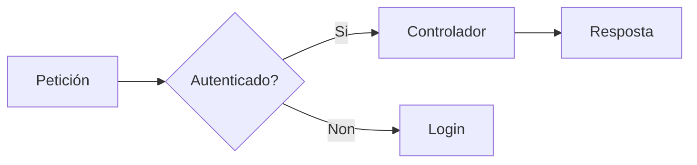

# Referencia md2pdf para redacción de documentos Markdown

Este documento describe as convencións e capacidades do sistema **md2pdf** para que
poidas xerar ficheiros Markdown compatibles coas tres saídas actuais: PDF con LuaLaTeX
(motor por defecto e de maior calidade tipográfica), DOCX e HTML5 autocontido.

---

## 1. Estrutura xeral do ficheiro

### Front matter YAML (opcional pero recomendado)

Coloca ao inicio do ficheiro para metadatos e información da portada:

```markdown
---
module: "Desenvolvemento web en contorno servidor"
subject: "UD3: Introdución a PHP"
activity: "A01: Estruturas de control"
school: "CIFP Rodolfo Ucha Piñeiro"
course: "Curso 2025-2026"
---

# A01: Estruturas de control
```

#### Que fai cada campo

| Campo | Onde aparece | Notas |
|---|---|---|
| `module` | Portada (`--titlepage`) en versaletas | Módulo profesional completo |
| `subject` | Portada — título principal `\Huge` | Unidade didáctica |
| `activity` | Portada + inicio da páxina de contido | Actividade concreta; aparece sempre, con ou sen `--titlepage` |
| `school` | Portada — bloque inferior | Nome do centro; adoita ir en `metadata.yaml` compartido |
| `course` | Portada — bloque inferior | Curso académico |
| `author` | **Só metadatos internos do PDF** | Non aparece na portada; vai en `metadata.yaml` |
| `keywords` | Metadatos internos do PDF | Para buscadores e accesibilidade |

O preprocesador **extrae os metadatos e elimina o bloque completo** antes de
pasalo a Pandoc. Ningún destes campos aparece como texto no corpo do documento.

O `# Título` (cabeceira de nivel 1) convértese automaticamente no título do PDF.
**Só debe haber un `#` por documento**, ao inicio. Todo o contido vai baixo `##` en diante.

#### Campos que adoitan ir en `metadata.yaml` compartido

Os campos que se repiten en todos os documentos dunha unidade (`author`, `school`,
`keywords`, `course`) convén poñelos nun `metadata.yaml` no mesmo directorio. O front
matter do `.md` sobreescribe campo a campo:

```yaml
# metadata.yaml (compartido por todos os .md do curso)
author: "Miguel Morales"
school: "CIFP Rodolfo Ucha Piñeiro"
keywords: "PHP, DAW, Backend"
course: "Curso 2025-2026"
```

### O que NON debes escribir

O preprocesador elimina automaticamente estas cousas; non as inclúas:

- `[TOC]` nin seccións manuais de índice (`## Índice` con listas de ligazóns)
- Separadores `---` entre seccións (úsaos só no front matter YAML)
- Numeración manual nas cabeceiras (`## 1.2. Título` → escribir `## Título`)

---

## 2. Cabeceiras e numeración automática

As seccións numéranse automaticamente (1, 1.1, 1.1.1…). Non engadas números ti.

Palabras clave nas cabeceiras que reciben un emoji automático:

- `Tarefa` → 🎯
- `Exercicio` → ✏️
- `Reto` → 🏆
- `Exemplo` → ▶️

```markdown
## Exercicio: Crear un controlador REST
## Tarefa: Implementar autenticación
```

---

## 3. Callouts (caixas de aviso)

Son a ferramenta principal para destacar información. Renderízanse con `tcolorbox` en LuaLaTeX, como bloques semánticos con CSS en HTML e como texto estruturado en DOCX.

### Sintaxe recomendada (divs Pandoc)

```markdown
::: note
Información xenérica que convén lembrar.
:::

::: tip
Consello práctico ou boa práctica.
:::

::: warning
Atención: algo que pode causar problemas se non se ten en conta.
:::

::: danger
Erro crítico ou acción irreversible. Usar con moderación.
Preséntase con a etiqueta **Crítico** en galego.
:::

::: info
Contexto adicional ou referencia a documentación externa.
:::
```

### Tipos dispoñibles e aliases en galego

| Tipo | Alias galego | Uso |
|------|-------------|-----|
| `note` | `nota` | Aclaración ou recordatorio |
| `tip` | `consello` | Boa práctica, atallo |
| `warning` | — | Precaución, comportamento inesperado |
| `danger` | `perigo` | Erro grave, dato sensible |
| `info` | — | Contexto, referencia externa |

### Sintaxe alternativa (GitHub/Obsidian)

Tamén funciona, pero a sintaxe de divs é preferible:

```markdown
> [!WARNING]
> Esta sintaxe tamén funciona.
```

### Callouts con contido estruturado

Os callouts poden conter calquera elemento Markdown: código, listas, táboas.
O preprocesador insire automaticamente a liña baleira tras `:::tipo` se falta, pero
como boa práctica escríbea ti explicitamente:

````markdown
::: warning

**Migración irreversible.** Antes de executar:

- Fai unha copia de seguridade da base de datos
- Verifica que non hai datos en produción afectados

```bash
php artisan migrate:rollback --step=1
```
:::
````

````markdown
::: tip

Os tres métodos máis útiles de Eloquent para paginación:

| Método | Devolve | Uso |
|--------|---------|-----|
| `paginate(n)` | `LengthAwarePaginator` | Páxinas numeradas |
| `simplePaginate(n)` | `Paginator` | Anterior/Seguinte |
| `cursorPaginate(n)` | `CursorPaginator` | Conxuntos grandes |
:::
````

---

## 4. Bloques de código

### Básico con linguaxe

**Especifica sempre a linguaxe.** O preprocesador auto-fixa os bloques sen linguaxe
substituíndoos por `` ```text `` e emitindo un aviso en stderr, pero é mellor escribilos
ben desde o principio. Usa `text` para saídas de terminal, diagramas ASCII ou calquera
contido que non sexa código:

````markdown
```php
$usuarios = User::where('activo', true)->get();
```

```bash
php artisan migrate --seed
```

```sql
SELECT * FROM users WHERE created_at > NOW() - INTERVAL 30 DAY;
```

```text
Saída do servidor:
[OK] Migrando: 2024_01_15_create_users_table
```
````

### Linguaxes frecuentes recoñecidas

`php`, `html`, `css`, `javascript`, `typescript`, `bash`, `sql`, `json`, `yaml`,
`xml`, `python`, `java`, `c`, `cpp`, `markdown`, `text`, `plaintext`

### Resaltado de liñas específicas (LuaLaTeX e HTML)

Usa o atributo `hl` para destacar liñas concretas. Moi útil cando o texto refire
a liñas específicas do código:

````markdown
```php {hl="3,5,8-10"}
public function store(Request $request)
{
    $validated = $request->validate([   // liña 3: validación
        'nome' => 'required|max:255',
        'email' => 'required|email',    // liña 5: campo email
    ]);

    $user = User::create($validated);   // liña 8: crear
    event(new UserRegistered($user));   // liña 9: evento
    return redirect()->route('users.index'); // liña 10: redirección
}
```
````

Formatos válidos para `hl`: `"3"`, `"1,3,5"`, `"2-6"`, `"1,3,7-9"`.

### Combinación de resaltado e referencia cruzada

Pódense combinar `hl=` e `#lst:` no mesmo bloque, e engadir o título con `: Texto`
na liña seguinte ao peche do bloque:

````markdown
```php {hl="5,6" #lst:validation}
public function store(Request $request)
{
    $request->validate([
        'nome'  => 'required|max:255',
        'email' => 'required|email|unique:users',
        'rol'   => 'required|in:admin,editor,lector',
    ]);
}
```
: Validación con regras múltiples

Como se ve na @lst:validation, as liñas 5 e 6 usan regras encadeadas.
````

### Diagramas Mermaid

Para D2/DOT, layouts, atributos e metadatos diagrams, consultar DIAGRAMAS.md.
Para gráficos de datos con bloques vega-lite/vegalite e JSON inline,
consultar VEGA-LITE.md e exemplos-vega-lite.md. Non usar URL de datos externas.

Os bloques con linguaxe `mermaid` renderízanse automaticamente antes de pasar o
documento a Pandoc. Úsase `mmdc` (Mermaid CLI) desde o preprocesado Python e o
formato depende do motor: PDF vectorial para LuaLaTeX, PNG para DOCX e SVG vectorial
para HTML5. D2, Graphviz e Vega-Lite seguen a mesma política de formatos.

````markdown

````

Soporta todos os tipos de diagrama de Mermaid: `flowchart`, `sequenceDiagram`,
`classDiagram`, `stateDiagram`, `erDiagram`, `gantt`, `pie`, `mindmap`, etc.

**Convencións recomendadas:**

- **Etiquetas curtas** dentro dos nodos. Para forzar un salto de liña dentro
  dun nodo, usar `<br/>`:
  ```
  A[Verificar<br/>contorna]
  ```
- **Sintaxe estándar de Mermaid**, sen extensións de Mermaid Live Editor que
  poidan non estar implementadas en `mmdc`.
- **Un só diagrama por bloque**. Se necesitas varios, usa varios bloques
  separados.

**Caché**: cada diagrama identifícase por hash do contido. Diagramas idénticos
non se re-renderizan entre execucións nin entre documentos distintos. O ficheiro
xerado vive en `/tmp/md2pdf-mermaid/` (Linux/macOS) ou `%TEMP%\md2pdf-mermaid\`
(Windows).

**Se `mmdc` non está instalado**, o bloque mantense como código fonte no PDF e
emítese un aviso en stderr; non hai fallo de compilación.

---

## 5. Táboas

Pandoc xera táboas con cabeceira repetida en cada páxina (longtable).
Usa aliñamento explícito cando conveña:

```markdown
| Método | Ruta | Controlador | Descrición |
|--------|------|-------------|------------|
| GET | `/users` | `index` | Lista todos os usuarios |
| POST | `/users` | `store` | Crea un novo usuario |
| GET | `/users/{id}` | `show` | Mostra un usuario |
| PUT | `/users/{id}` | `update` | Actualiza un usuario |
| DELETE | `/users/{id}` | `destroy` | Elimina un usuario |
```

Para columnas con texto longo, o sistema axusta os anchos automaticamente
proporcionalmente ao contido (filtro `auto-table-widths.lua`).

### Control de anchos de columna

O filtro `auto-table-widths.lua` calcula os anchos **analizando o contido real das celas**, non a lonxitude dos `---`. Cada columna recibe un ancho proporcional á cela máis longa que conteña, cun mínimo garantido para que o código curto non rompa.

Normalmente non precisas facer nada: o resultado é correcto de forma automática. Pero hai dous casos nos que podes axudar ao filtro:

**Columnas con moito código longo**: o filtro limita a lonxitude máxima a 60 chars por cela para que unha columna con nomes longos non espreme as demais. Se queres que unha columna específica sexa máis ancha, ponlle máis contido real ou divide a información en filas.

**Proporcións moi desequilibradas**: se todas as celas dunha columna son moi curtas pero precisa ser ancha, engade texto descritivo en vez de confiar nos `---`. O filtro ignora a lonxitude dos separadores.

**Evita cadeas longas sen espazos nas celas** (URLs, nomes de clase completos,
código sen separadores), xa que fórzana a que a columna se expanda sen límite:

```markdown
❌ Problemático:
| Clase | Descrición |
|-------|------------|
| `App\Http\Controllers\Api\V2\UserAuthenticationController` | Autentica |

✅ Mellor — rompe o namespace ou abrevia:
| Clase | Descrición |
|-------|------------|
| `UserAuthenticationController` | Autentica usuarios vía API v2 |
```

Se necesitas mostrar un namespace completo, usa código en liña fóra da táboa
e referenciao desde ela.

### Rotura de páxina en táboas longas

`longtable` repite a cabeceira automaticamente en cada páxina, pero corta as
filas onde cabe, sen ter en conta a lóxica do contido. Para minimizar
roturas inapropiadas:

**Agrupa as filas relacionadas en táboas separadas** en vez dunha táboa xigante.
Unha táboa por concepto é máis lexible e evita cortes no medio dunha sección lóxica:

```markdown
✅ Mellor que unha táboa de 30 filas:

Métodos de colección:

| Método | Descrición |
|--------|------------|
| `all()` | Devolve todos os rexistros |
| `find($id)` | Busca por clave primaria |
| `first()` | Primeiro resultado |

Métodos de filtrado:

| Método | Descrición |
|--------|------------|
| `where()` | Filtra por condición |
| `whereIn()` | Filtra por lista de valores |
| `whereBetween()` | Filtra por rango |
```

**Pon as filas máis importantes ao inicio** da táboa. Se a rotura é inevitable,
é mellor que quede ao final dunha sección lóxica ca no medio.

**Evita celas con moito texto** (varios parágrafos). Se unha cela require
explicación extensa, usa a táboa só para o resumo e desenvolve o detalle
nun parágrafo ou lista debaixo.

### Saltos de liña dentro dunha cela

Para forzar un salto de liña dentro dunha cela de táboa, usa `<br>`. O filtro
`br.lua` convérteo en `\newline{}` de LaTeX automaticamente:

```markdown
| Opción | Valores posibles |
|--------|-----------------|
| `visibility` | `public`<br>`protected`<br>`private` |
| `type` | `int`<br>`string`<br>`bool` |
```

Non uses outros mecanismos (barra invertida, doble espazo) — só funcionan
fóra de táboas.

### Aliñamento vertical das celas

O sistema aliña automaticamente o contido de todas as celas á **parte superior**
de cada fila (`p{}` por defecto en LaTeX). O código en liña dentro de celas
altas tamén aliña arriba grazas ao `\leavevmode` que o filtro `auto-table-widths.lua`
engade automaticamente. Non precisas facer nada para conseguir este comportamento.

---

## 6. Imaxes e figuras

### Imaxe simple (en liña, sen pé de figura)

```markdown

```

### Figura con pé de figura (recomendado)

O texto alternativo convértese no pé de figura numerado en LuaLaTeX e HTML:

```markdown

```

### Tamaño personalizado

```markdown
{width=80%}
```

As imaxes nunca sobresaen da marxe (limitadas a `\linewidth` automaticamente).

### Imaxes grandes e PDF vectoriais

::: danger

**Imaxes PNG/JPG maiores de ~800 px de ancho** ou **PDF vectoriais** sen atributo de ancho
poden **colgar LuaLaTeX indefinidamente** (sen erro, sen saída — só un proceso que non
remata). Isto ocorre porque a combinación de `\pandocbounded{}` (Pandoc 3.x), `adjustbox`
con `max width=\linewidth` e `float{H}` entra nun bucle calculando o tamaño da imaxe.

**Solución** — usa sempre `{width=...}` no Markdown:

```markdown
{width=100%}
{width=80%}
```

Isto fai que Pandoc xere `\includegraphics[width=\textwidth]{...}` directamente,
evitando o cálculo automático de tamaño.

**Alternativa**: redimensionar a imaxe a ≤800 px antes de incluíla:

```bash
magick img/diagrama.png -resize 800x img/diagrama.png
```

:::

### Posición das figuras

En LuaLaTeX as figuras aparecen **exactamente onde se colocan no texto** (opción `H`
de LaTeX). Non flotan a outra posición. Polo tanto:

- Coloca a imaxe **despois** do parágrafo que a introduce, nunca antes
- Non intentes controlar a posición con comandos LaTeX nin atributos Pandoc especiais
- Se queres que a imaxe quede nunha páxina concreta, colócaa no punto do texto que corresponda

---

## 7. Listas de definición

Útiles para glosarios, listados de parámetros, propiedades dun obxecto ou termos técnicos.
Prodúcen saída elegante con o termo en negra e a definición indentada:

```markdown
`app/`
:   Directorio principal da aplicación. Contén modelos, controladores e providers.

`routes/`
:   Definición de todas as rutas da aplicación. Os ficheiros principais son
    `web.php` e `api.php`.

`resources/views/`
:   Vistas Blade. Os ficheiros teñen extensión `.blade.php`.
```

Pódese usar tamén para documentar parámetros dunha función ou columnas dunha táboa:

```markdown
`$perPage`
:   Número de resultados por páxina. Defecto: `15`.

`$columns`
:   Array de columnas a seleccionar. Defecto: `['*']` (todas).
```

---

## 8. Referencias cruzadas

md2pdf resolve de forma propia referencias a **figuras e táboas** en LuaLaTeX e HTML, sen depender de `pandoc-crossref`. DOCX non resolve actualmente estas referencias.

### Figuras

```markdown
{#fig:lifecycle}

Como se mostra na @fig:lifecycle, a petición pasa polo kernel...
```

### Táboas

```markdown
| Código | Significado |
|--------|-------------|
| 200 | OK |
| 404 | Non atopado |

: Códigos HTTP máis comúns {#tbl:http-codes}

A @tbl:http-codes resume os códigos máis frecuentes.
```

Admítense `@fig:...` para figuras e `@tbl:...` ou `@tab:...` para táboas. A inicial maiúscula (`@Fig:...`, `@Tbl:...`) produce «Figura»/«Táboa» en vez de «figura»/«táboa». En HTML as referencias son ligazóns internas clicables.

As referencias `@sec:`, `@eq:` e `@lst:` **non se resolven automaticamente** no pipeline actual. Se necesitas mencionar unha sección ou unha listaxe, faino polo seu nome no texto.

---

## 9. Ecuacións matemáticas

Renderízanse con STIX Two Math, ben emparellada con Source Serif 4.

### En liña

```markdown
A complexidade do algoritmo é $O(n \log n)$ no caso promedio.
```

### En display (bloque centrado)

```markdown
$$
\bar{x} = \frac{1}{n} \sum_{i=1}^{n} x_i
$$
```

### Con referencia cruzada

```markdown
$$
P(A|B) = \frac{P(B|A) \cdot P(A)}{P(B)}
$$ {#eq:bayes}

O teorema de Bayes (@eq:bayes) aplícase aquí do seguinte modo...
```

---

## 10. Listas

### Con viñetas

```markdown
As vantaxes principais son:

- Separación de responsabilidades clara
- Testabilidade de cada capa por separado
- Reutilización do modelo en múltiples vistas
```

### Numeradas

```markdown
Para instalar Laravel:

1. Instalar Composer globalmente
2. Executar `composer create-project laravel/laravel proxecto`
3. Configurar o ficheiro `.env`
4. Executar `php artisan key:generate`
```

### Encaixadas (máximo 2 niveis recomendados)

```markdown
- Rutas
    - Web (`routes/web.php`)
    - API (`routes/api.php`)
- Controladores
    - Resource controllers
    - Invokable controllers
```

---

## 11. Énfase e formato en liña

```markdown
**negra** para termos clave ou conceptos importantes
*cursiva* para títulos de documentos, termos en lingua estranxeira
`código en liña` para nomes de funcións, variables, ficheiros, comandos
```

O `código en liña` renderízase en azul discreto en LuaLaTeX para distinguirse
visualmente do texto sen romper o fluxo de lectura.

### Barras invertidas en código en liña (LuaLaTeX)

As secuencias con barra invertida como `\n`, `\t`, `\r`, `\\` dentro de código
en liña (acentos graves) no **texto corrido** renderízanse incorrectamente en
LuaLaTeX. A barra invertida dentro de `\texttt{}` interprétase como inicio
de comando LaTeX, producindo saídas coma `\{}n` ou caracteres inesperados.

Dentro de **bloques de código fenced** (`` ``` ``) non hai problema porque usan
escaping completo.

**Solución** — evitar barras invertidas en código en liña dentro da prosa.
Describir o carácter con palabras ou usar un bloque de código:

```markdown
❌ Problemático:
Se a cadea non inclúe `\n`, as saídas quedan pegadas.

✅ Correcto — describir con palabras:
Se a cadea non inclúe un salto de liña, as saídas quedan pegadas.

✅ Correcto — usar bloque de código:
Se a cadea non inclúe o carácter de escape:

    \n

as saídas quedan pegadas.
```

Isto afecta unicamente ao motor LuaLaTeX; DOCX non ten este problema.

---

## 12. Blockquotes

Os blockquotes normais (sen tipo de callout) renderízanse como caixas con borde
lateral azul, distintas dos callouts tipados:

```markdown
> "Convention over configuration" é o principio central de Rails,
> adoptado tamén por Laravel no seu enfoque de estrutura de proxecto.
```

Úsaos para citas textuais, non para avisos (que van en callouts).

---

## 13. Emojis nas cabeceiras e texto

Os emojis no texto corrido convértense automaticamente en iconas vectoriais
(FontAwesome 5) en LuaLaTeX, polo que se ven perfectamente en calquera zoom:

| Emoji | Uso recomendado |
|-------|----------------|
| ⚠️ | Aviso en texto corrido |
| 💡 | Consello rápido sen caixa |
| ✅ | Resultado correcto, validación |
| ❌ | Resultado incorrecto, erro |
| 📝 | Nota rápida |
| 🔑 | Concepto clave, autenticación |
| 🚀 | Posta en marcha, deploy |
| ⚙️ | Configuración |
| 💻 | Ambiente local, terminal |

Non os uses en exceso; un por parágrafo como máximo.

---

## 14. Notas ao pé

```markdown
Laravel usa Eloquent ORM[^eloquent] como capa de abstracción da base de datos.

[^eloquent]: Eloquent implementa o patrón Active Record, onde cada modelo
    corresponde a unha táboa e cada instancia a unha fila.
```

---

## 15. Robustez do pipeline e diagnóstico de erros

O preprocesador de `md2pdf` corrixe automaticamente os problemas estruturais máis
frecuentes antes de chamar a Pandoc. Non é necesario facer ningunha revisión manual
para que a compilación funcione, pero é útil entender que se corrixe e que non, para
interpretar os avisos en stderr e diagnosticar fallos en casos extremos.

### O que o pipeline corrixe automaticamente

**Front matter YAML.**
Se o ficheiro comeza cun bloque `---`…`---`, o preprocesador extrae os metadatos
(`module`, `subject`, `activity`, `school`, `author`, `course`, `keywords`) e elimina
o bloque completo antes de pasalo a Pandoc. Sen esta eliminación, as liñas YAML
aparecerían como texto plano no corpo do PDF.

**Bloques de código sen linguaxe.**
Cando o preprocesador detecta un `` ``` `` de apertura sen linguaxe, substituíao por
`` ```text `` e emite un aviso en stderr:

```
⚠  Auto-fixado: bloque de código sen linguaxe → ```text
```

Non causa fallo de compilación, pero o aviso indica que o ficheiro fonte non está
ben escrito. A boa práctica é especificar sempre a linguaxe explicitamente.

**Callouts sen liña baleira tras a apertura.**
Pandoc require unha liña baleira entre `:::tipo` e o primeiro contido para recoñecer
o bloque como div. O preprocesador insírea automaticamente en todos os callouts que a
omitan, tanto nos convertidos desde `> [!TYPE]` como nos escritos directamente no `.md`.

**Separadores `---`.**
Eliminados en todo o documento (incluíndo dentro de callouts) antes de chegar a Pandoc.

### O que o pipeline NON pode corrixir

**Bloque de código aberto e nunca pechado.** Se falta o `` ``` `` de peche, o resto
do documento é interpretado como contido do bloque. O lint avisa antes da compilación,
pero o ficheiro faría fallar LaTeX con `File ended while scanning`.

**`:::` de peche ausente.** Un callout sen `:::` de peche produce LaTeX malformado.
O lint detecta e informa da liña onde abriu.

**Múltiples cabeceiras `#` de nivel 1.** O primeiro `#` convértese no título do PDF;
os seguintes producen un segundo título no corpo do documento. O lint avisa de todos.

**Imaxes moi grandes ou PDF vectoriais sen `{width=...}`.** LuaLaTeX cólgase
indefinidamente (sen erro nin mensaxe) ao intentar calcular o tamaño da imaxe.
Afecta a PNG/JPG de máis de ~800 px de ancho e a calquera PDF vectorial sen
dimensións intrínsecas. A solución é engadir `{width=100%}` ou redimensionar a
imaxe. Ver a sección 6 (Imaxes e figuras) para os detalles.

**Barras invertidas en código en liña no texto corrido.** Secuencias como `\n`,
`\t` ou `\\` dentro de acentos graves na prosa renderízanse incorrectamente
(por exemplo `\{}n`) porque LuaLaTeX interpreta a barra invertida en `\texttt{}`
como inicio de comando. A solución é describir o carácter con palabras ou usar
un bloque de código fenced. Ver a sección 11 para os detalles.

### Validación proactiva con `--check` e `--strict`

O flag `--check` executa o lint sen compilar e informa de todos os problemas:

```bash
md2pdf documento.md --check
```

O flag `--strict` combínase con `--check` e trata as advertencias como erros
(exit code `1`), útil en scripts de xeración automática onde prefires un fallo
limpo a un PDF mal formado:

```bash
md2pdf documento.md --check --strict
```

Sen `--check` (comportamento por defecto), os problemas detectados móstranse como
avisos en stderr pero a compilación continúa igualmente.

### Erros LaTeX e o que indican

Se a compilación falla a pesar do preprocesador (ficheiros importados doutras
ferramentas, edición manual post-procesamento, etc.), a mensaxe de LaTeX orienta
a busca:

| Mensaxe LaTeX | Causa probable en md2pdf |
|---|---|
| `Extra }, or forgotten $` | Callout sen pechador `:::` correspondente |
| `Undefined control sequence` | Bloque de código non pechado que "tragou" un callout ou cabeceira |
| `Missing $ inserted` | Carácter especial LaTeX (`_`, `^`, `$`, `&`) en texto corrido fóra de `$...$` |
| `File ended while scanning` | Bloque de código aberto que nunca se pecha |
| `Paragraph ended before \@makecol` | Callout malformado; combinación de bloque non pechado e div a medio procesar |
| *(LuaLaTeX cólgase sen erro)* | Imaxe moi grande (>800 px) ou PDF vectorial sen `{width=...}`; ver sección 6 |

---

## Resumo de prioridades

Cando redactes un documento técnico con este sistema:

1. **Pon sempre `activity`** no front matter — identifica a actividade en todas as páxinas
2. **Usa callouts** para información importante, non texto en negra illada
3. **Especifica sempre a linguaxe** nos bloques de código (inclúe `text` para saídas)
4. **Usa `hl=`** para resaltar liñas que mencionas no texto
5. **Usa diagramas Mermaid** para fluxos, secuencias e relacións — máis lexibles que ASCII art en `text`
6. **Usa referencias cruzadas** (`@fig:`, `@tbl:`) en vez de "a imaxe de abaixo"
7. **Non numeres** cabeceiras nin crees TOC manuais
8. **Un só `#`** ao inicio como título; o resto desde `##`
9. **Engade `{width=100%}`** a imaxes grandes (>800 px) ou PDF vectoriais para evitar que LuaLaTeX se colgue
10. **Evita barras invertidas en código en liña** na prosa (describe con palabras ou usa un bloque de código)


## Empaquetado IMS para Moodle

- CLI: `md2pdf <inputs> --ims paquete.zip [--ims-title "Título"]`.
- Non é un motor: reutiliza `engine="html"` para cada Markdown.
- Implementación: `md2pdf/ims.py`.
- O ZIP leva `imsmanifest.xml` na raíz e un HTML autocontido por recurso.
- IMS Content Packaging 1.1.4, recursos `type="webcontent"`.
- A orde dos `item` coincide coa orde de `collect_files()`.
- Título de cada item: `activity` → `title` → primeiro H1 → stem.
- Ligazóns relativas a `.md` incluídos reescríbense a `.html`; con `--strict`, ligazóns a Markdown locais non incluídos fan fallar o empaquetado.
- `--watch` e `-o` non aplican en modo IMS.
